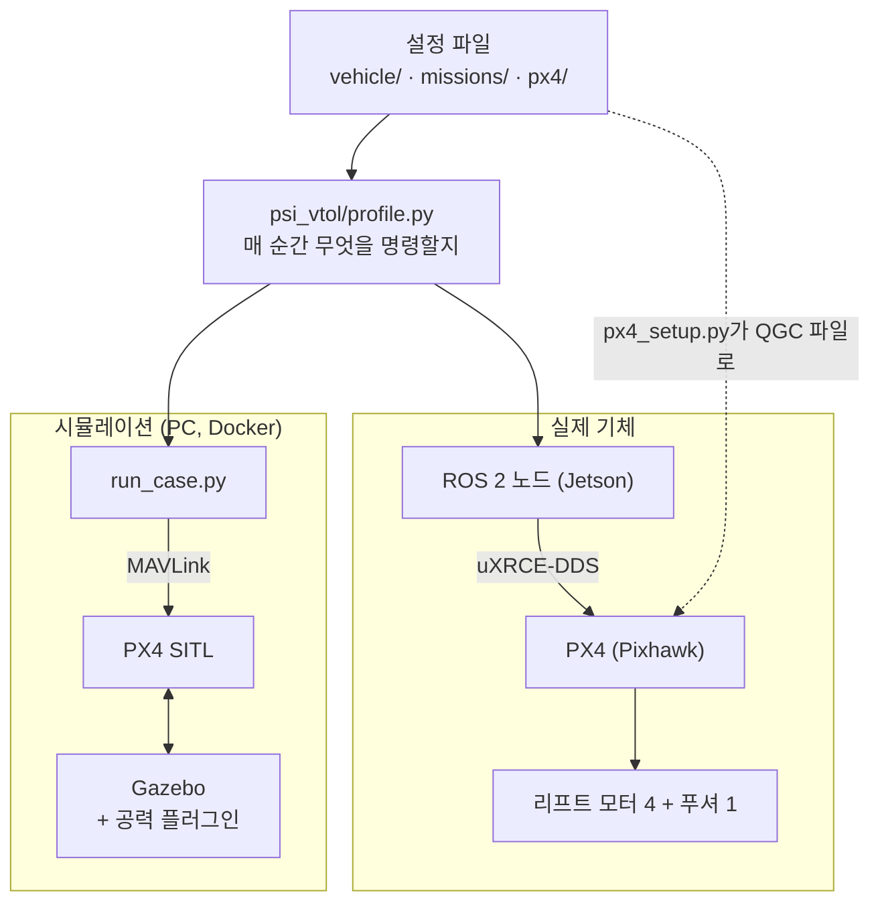
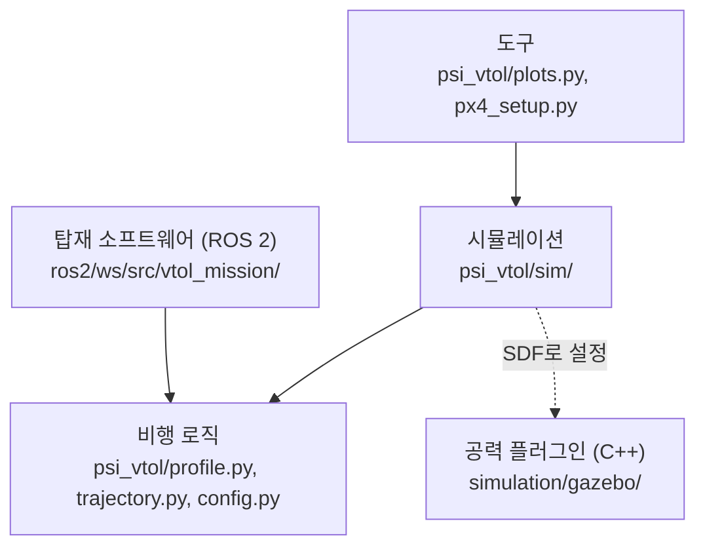
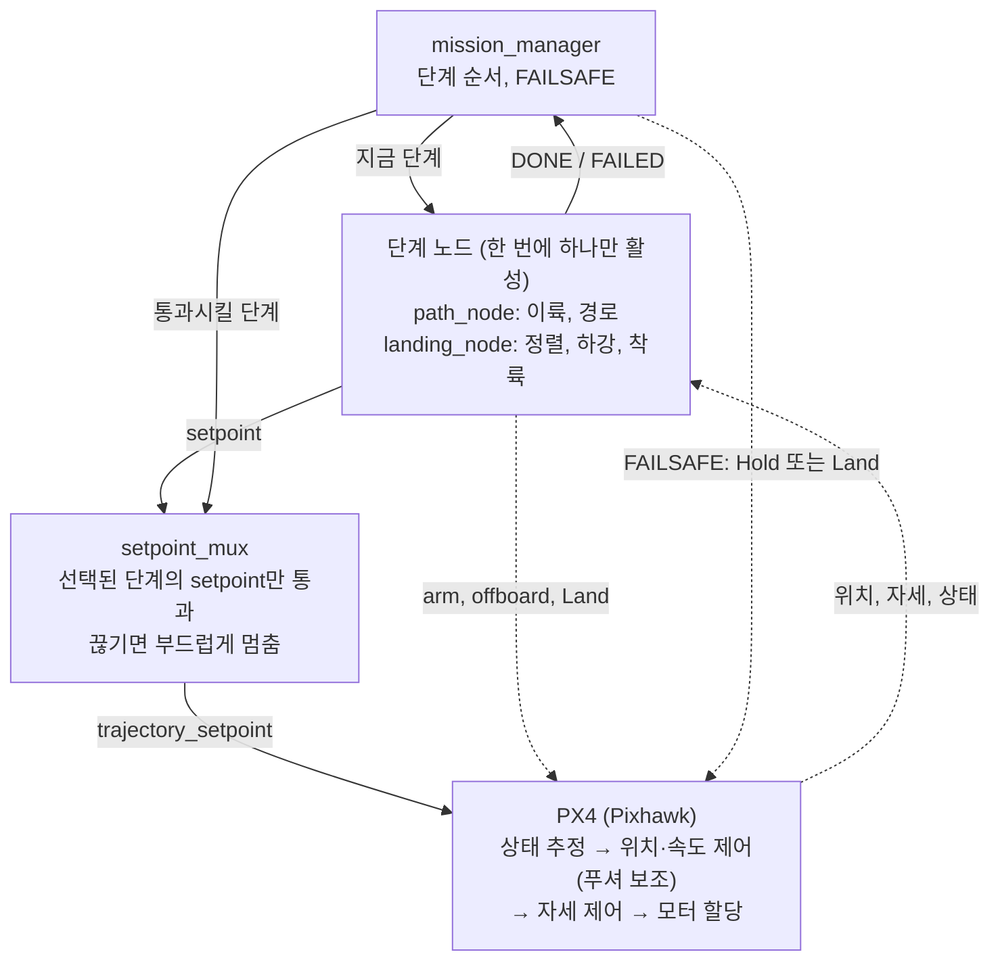
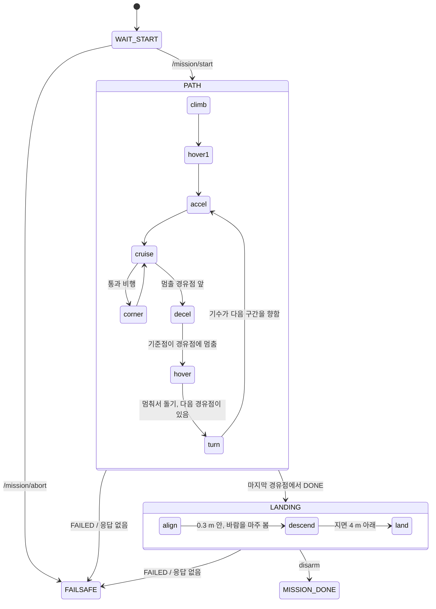
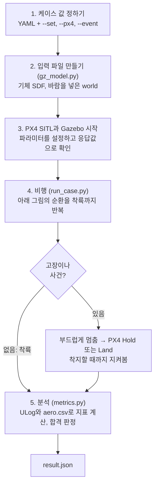

# 0. 전체 구조

이 저장소가 어떻게 짜여 있고, 비행할 때 무엇이 무엇에게 명령을 보내는지 그림으로 정리했습니다.
각 부분의 자세한 내용은 번호가 붙은 다른 문서에 있습니다.

## 1. 한눈에 보기

비행 중에 매 순간 무엇을 명령할지는 `psi_vtol/profile.py` 한 곳에서 정합니다. 시뮬레이션과 실제 기체가
이 코드를 함께 쓰므로, 시뮬레이션에서 비행한 것이 실제 기체가 받을 명령과 같습니다. PX4는 어느 쪽이든
수정하지 않은 v1.17.0입니다.

## 2. 코드 지도

비행 로직(`psi_vtol`의 세 파일)은 ROS도 시뮬레이터도 모릅니다. 시뮬레이션과 탑재 소프트웨어가 각자 이
로직을 가져다 씁니다.

| 파일 | 하는 일 |
|---|---|
| `psi_vtol/profile.py` | 비행 단계를 차례로 진행하며 매 순간의 setpoint를 만들고, 경로를 따라가지 못하는 고장을 알아챔 |
| `psi_vtol/trajectory.py` | 경로(직선 구간과 부드러운 모서리)와 속도 계획(가속도를 서서히 바꿈) |
| `psi_vtol/config.py` | 기체·임무·스터디·PX4 YAML을 읽어 합침 |
| `psi_vtol/sim/run_case.py` | PX4 SITL과 Gazebo를 띄우고 케이스 하나를 MAVLink로 비행, 사건 주입 |
| `psi_vtol/sim/gz_model.py` | 케이스 값으로 기체 SDF, world, PX4 기하 파라미터를 만듦 |
| `psi_vtol/sim/metrics.py` | ULog와 `aero.csv`로 지표를 계산하고 합격을 판정 |
| `psi_vtol/sim/sweep.py` | 스터디의 케이스를 차례로 비행하고 표로 모음 |
| `psi_vtol/sim/start.py` | ROS 2 노드를 시험할 PX4 SITL을 띄움 |
| `psi_vtol/plots.py` | 보고서 그림 |
| `psi_vtol/px4_setup.py` | 실제 기체용 QGC 파라미터 파일 |
| `vtol_mission/mission_manager.py` | 단계 순서와 FAILSAFE |
| `vtol_mission/path_node.py`, `landing_node.py` | 단계 노드: 프로파일로 setpoint를 만듦 (`source.py`가 공통 부모) |
| `vtol_mission/setpoint_mux.py` | 선택된 단계의 setpoint만 PX4로 보냄 |
| `simulation/gazebo/AeroSystem.cc` | 날개·동체 공력과 추진 손실을 더하는 Gazebo 플러그인 |

## 3. 탑재 비행 소프트웨어

Jetson의 노드는 "어디로 얼마나 빨리"만 정하고, 자세 제어와 모터 배분은 PX4가 합니다. 한 번에 한 단계
노드만 활성이고, PX4에 setpoint를 보내는 것은 `setpoint_mux` 하나뿐입니다. Jetson과 Pixhawk 사이는
Micro XRCE-DDS Agent가 시리얼로 잇습니다.

토픽 이름과 watchdog은 [4. 탑재 소프트웨어](04_onboard.md)에 있습니다.

## 4. 임무의 흐름

`mission_manager`는 단계(노드) 단위로, `profile.py`는 그 안의 비행 단계(phase) 단위로 진행합니다. PATH
안에서는 계획된 기준점을 따라 납니다. 통과 비행(기본)은 가속한 뒤 순항과 모서리(`corner`)를 번갈아 지나
마지막 구간에서 감속하고, 멈춰서 돌기는 경유점마다 회전–가속–순항–감속–호버를 반복합니다. 단계 이름에는
구간 번호가 붙습니다(`accel1`, `corner1`, `hover5`, `turn2`, …).

단계마다 시간 상한이 있습니다. 상한을 넘기거나, 프로파일이 경로를 따라가지 못함을 알아채거나, PX4가
offboard에서 빠지면 단계 노드가 `FAILED`를 보고하고 `FAILSAFE`로 갑니다. FAILSAFE에서는 mux가 기체를
부드럽게 멈추고, 그 뒤 PX4의 Hold에 넘깁니다. 앞으로 갈 수 없는 고장(푸셔 고장, 크게 뒤처짐)이면 Land에
넘깁니다.

| 단계 | 하는 일 |
|---|---|
| climb, hover1 | 이륙 지점 위로 목표 고도까지 상승하고 잠시 호버 |
| turn*i* | 멈춰서 돌기: 다음 경유점 쪽으로 기수를 돌림 (호버 상태, 20°/s, 기수가 실제로 돌 때까지) |
| accel*i*, cruise*i*, decel*i* | 구간 *i*를 기준점을 따라 가속–순항–감속. 감속은 경유점에서 정확히 멈추도록 계산됨 |
| corner*i* | 통과 비행: 구간 *i*에서 *i+1*로 반경 15 m 곡선, 옆으로 약 10° 기울여 돎 |
| hover*j* | 멈춘 경유점 위에서 호버 |
| align | 착륙 지점 위에 자리를 잡고 기수를 바람 쪽으로 돌림 |
| descend, land | 착륙 지점(기본은 이륙 지점) 위로 하강, PX4 Land 모드로 착륙 |

순항 속도가 높고 구간이 짧으면 순항 없이 가속 다음에 바로 감속이나 모서리가 옵니다(50 m 정사각형을 6 m/s
이상으로 날 때).

## 5. 시뮬레이션 한 번의 흐름

`python -m psi_vtol.sim.run_case`를 실행하면 다음 순서로 진행됩니다.

비행하는 동안에는 다음 순환이 계속 돕니다. 실제 기체에서 `run_case.py` 자리에 ROS 2 노드가, Gazebo 자리에
실제 기체가 들어갑니다.

PX4는 Gazebo의 시계를 따라가지만, Gazebo는 PX4를 기다리지 않습니다. PX4 v1.17의 Gazebo bridge에는
lockstep이 없습니다(`src/modules/simulation/gz_bridge`). 그래서 컴퓨터가 바빠 PX4가 뒤처지면 모터 명령이
시뮬레이션 시간으로 늦게 도착하고, 실제 기체에는 없는 제어 지연이 생깁니다. 시뮬레이션은 실제의 4배로
흐르고, 센서 잡음과 돌풍의 seed는 고정하지 않아서 같은 케이스도 결과가 조금씩 다릅니다.
