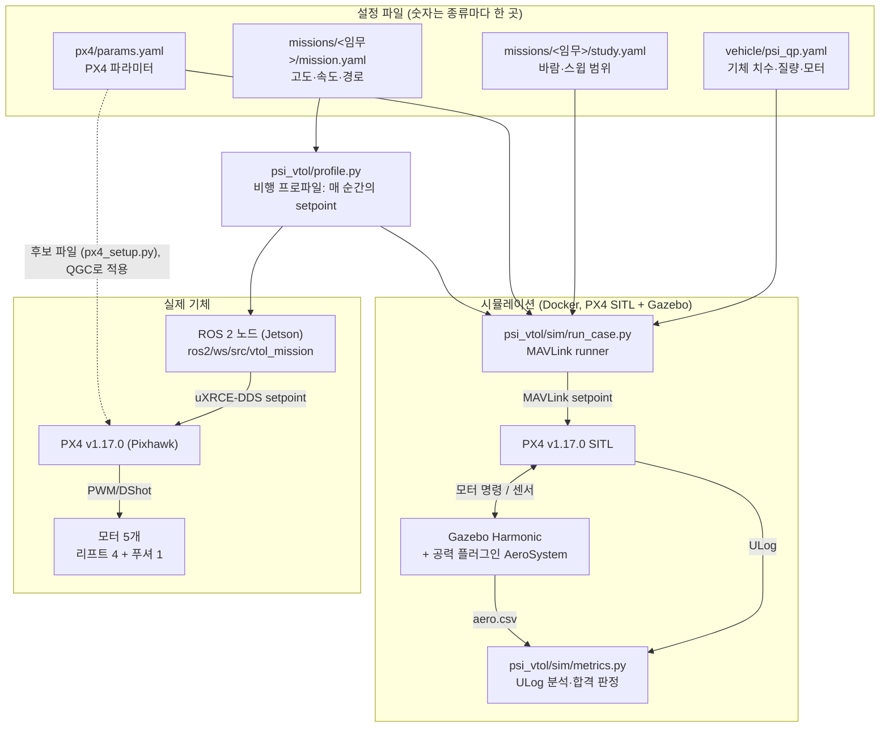
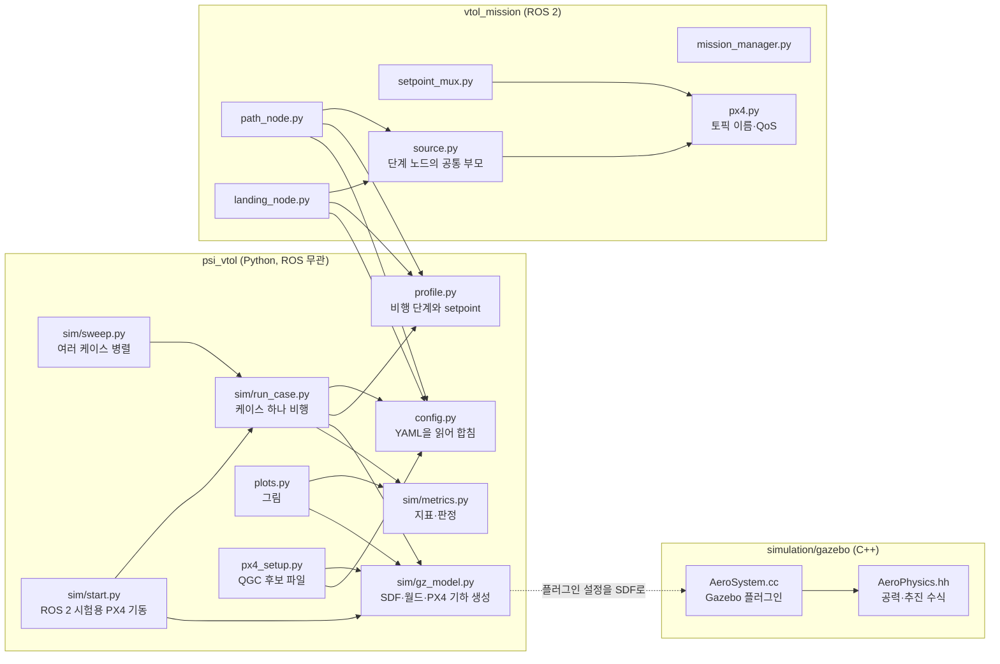
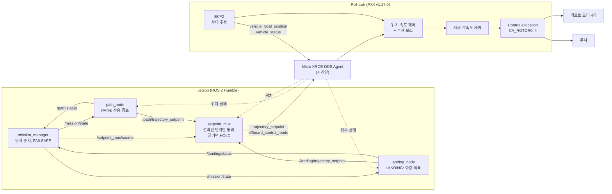
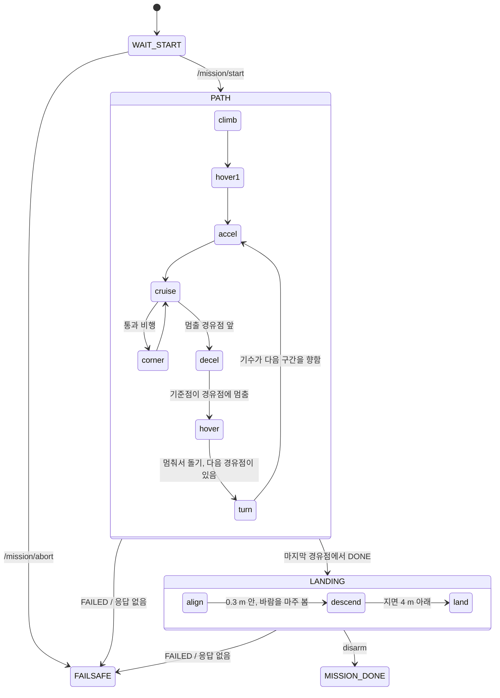
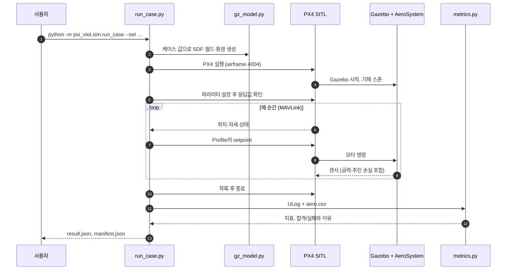

# 0. 전체 구조

이 저장소가 어떻게 짜여 있고, 비행할 때 무엇이 무엇에게 명령을 보내는지 그림으로 정리했습니다.
각 부분의 자세한 내용은 번호가 붙은 다른 문서에 있습니다.

## 1. 한눈에 보기

같은 비행 프로파일 코드(`psi_vtol/profile.py`)를 시뮬레이션과 실제 기체가 함께 씁니다. 시뮬레이션은
MAVLink로 PX4 SITL에 명령을 보내고, 실제 기체에서는 Jetson의 ROS 2 노드가 uXRCE-DDS로 Pixhawk의
PX4에 보냅니다. PX4는 어느 쪽이든 수정하지 않은 v1.17.0입니다.

## 2. 코드 지도

화살표는 "이 모듈이 저 모듈을 쓴다"는 뜻입니다. `psi_vtol`은 ROS에 의존하지 않고, ROS 2 패키지가
`psi_vtol`의 프로파일을 가져다 씁니다.

## 3. 탑재 비행 소프트웨어

Companion computer는 "어디로 얼마나 빨리"만 정하고, 자세 제어와 모터 배분은 PX4가 합니다. PX4에
setpoint를 보내는 노드는 `setpoint_mux` 하나뿐입니다.

## 4. 임무의 흐름

`mission_manager`는 단계(노드) 단위로, `profile.py`는 그 안의 비행 단계(phase) 단위로 진행합니다. PATH
안에서는 경로를 계획된 기준점을 따라 납니다. 통과 비행(기본)은 가속한 뒤 순항과 모서리(`corner`)를 번갈아
지나 마지막 구간에서 감속하고, 멈춰서 돌기는 경유점마다 회전–가속–순항–감속–호버를 반복합니다. 단계
이름에는 구간 번호가 붙습니다(`accel1`, `corner1`, `hover5`, `turn2`, …). 단계마다 시간 상한이 있고,
넘기거나, 프로파일이 경로를 따라가지 못함을 알아채거나, PX4가 offboard에서 빠지면 `FAILED`를 보고해
`FAILSAFE`로 갑니다. FAILSAFE에서는 mux가 기체를 부드럽게 멈추고, 그 뒤 PX4의 Hold(푸셔 고장이면
Land)에 넘깁니다.

| 단계 | 하는 일 |
|---|---|
| climb, hover1 | 이륙 지점 위로 목표 고도까지 상승하고 잠시 호버 |
| turn*i* | 멈춰서 돌기: 다음 경유점 쪽으로 기수를 돌림 (호버 상태, 20°/s, 기수가 실제로 돌 때까지) |
| accel*i*, cruise*i*, decel*i* | 구간 *i*를 기준점을 따라 가속–순항–감속. 감속은 경유점에서 정확히 멈추도록 계산됨 |
| corner*i* | 통과 비행: 구간 *i*에서 *i+1*로 반경 15 m 곡선, 옆으로 약 10° 기울여 돎 |
| hover*j* | 멈춘 경유점 위에서 호버 |
| align | 착륙 지점 위에 자리를 잡고 기수를 바람 쪽으로 돌림 |
| descend, land | 착륙 지점(기본은 이륙 지점) 위로 하강, PX4 Land 모드로 착륙 |

## 5. 시뮬레이션 한 번의 흐름

PX4는 Gazebo의 시계를 따라가지만, Gazebo는 PX4를 기다리지 않습니다. PX4 v1.17의 Gazebo bridge에는
lockstep이 없습니다(`src/modules/simulation/gz_bridge`). 그래서 컴퓨터가 바빠 PX4가 뒤처지면 모터 명령이
시뮬레이션 시간으로 늦게 도착하고, 실제 기체에는 없는 제어 지연이 생깁니다. 목표 배속은 실제의 4배입니다.
센서 잡음과 돌풍의 seed는 고정하지 않아서 같은 케이스도 결과가 조금씩 다릅니다.
