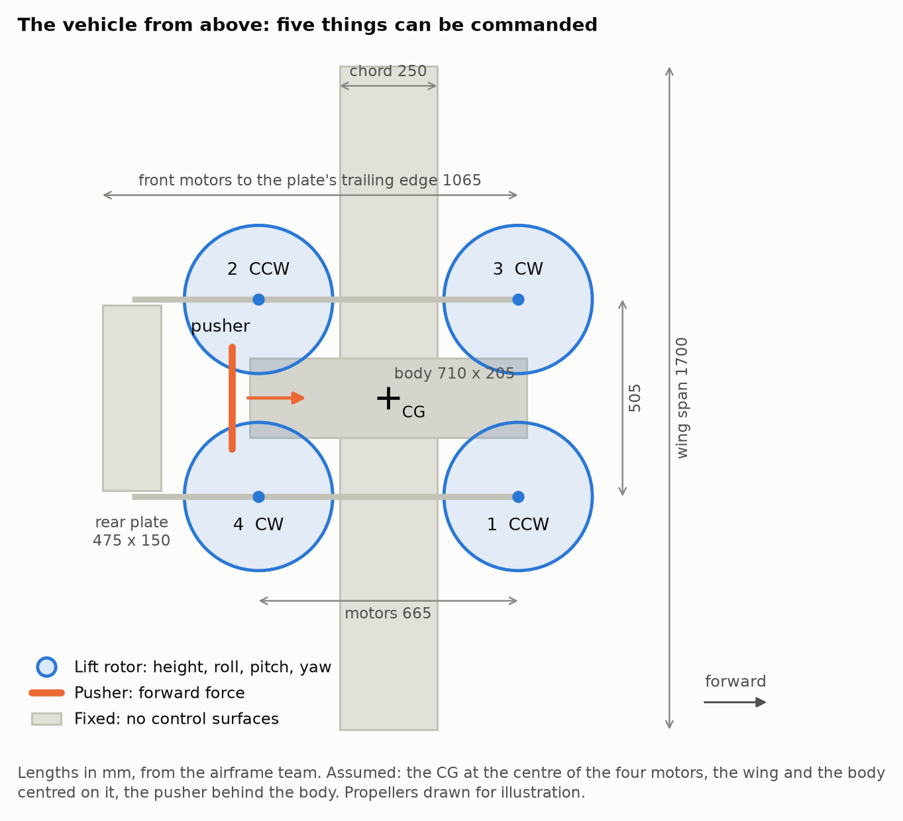

# 1. 기체

기체 수치는 [`vehicle/psi_qp.yaml`](../vehicle/psi_qp.yaml) 한 곳에만 적습니다. 값마다 출처(GIVEN, DERIVED,
ASSUMED, MEASURED)를 적어 두었습니다. 일부는 동체팀 자료이고 나머지는 가정이며, 실제 기체에서 측정한
값은 아직 없습니다.

| 항목 | 값 | 출처 |
|---|---|---|
| 전비중량 | 7 kg | eCalc 계산 기준 |
| 주익 | NACA 4415, 스팬 1700 mm, 시위 250 mm, 1.5 kg | 동체팀 |
| 리프트 모터 4개 | 전후 665 mm, 좌우 505 mm 직사각형의 꼭짓점 | 동체팀 |
| 푸셔 1개 | 동체 뒤 | 위치·사양 미정 |
| 뒤쪽 평판 | 475 × 150 mm, 붐 사이. 수직 꼬리 없음 | 동체팀 |
| 동체 | 710 × 205 × 215 mm | 동체팀 |
| 리프트 추력 대 중량비 | 1.9 | eCalc |
| 호버 시간 | 10.6분 | eCalc |

## 제어할 수 있는 곳

명령할 수 있는 것은 모터 다섯 개의 추력뿐입니다. 조종면이 없고, 날개와 평판은 고정입니다.

| 움직임 | 무엇으로 만드는가 | 여유 |
|---|---|---|
| 고도 | 리프트 로터 4개의 추력 합 | 정적 추력비 약 1.9; 실측 필요 |
| Roll | 좌우 리프트 로터의 추력 차 | 평균 추력·CG·공력에 따라 달라짐 |
| Pitch | 앞뒤 리프트 로터의 추력 차 | wing/tail 모멘트와 푸셔 오프셋도 보상 |
| Yaw (기수 방향) | 회전 방향이 다른 두 쌍의 반토크 차 | 가장 작음 |
| 전진 | 푸셔 추력 | 푸셔 최대 추력 |
| 감속 | 푸셔를 끄고 리프트 로터로 기수를 듦 | |
| 옆 이동 | 리프트 로터로 기체를 옆으로 기울임 | |

날개 양력을 독립적으로 명령하는 조종면은 없습니다. 속도·받음각으로 간접적으로 바뀌며,
속도가 붙으면 리프트 로터의 부담을 덜어 갑니다. 너무 많이 덜어 주면 자세 제어 여유도
줄어들 수 있습니다. 새 모델은 주익의 독립 pitching moment도 포함합니다.

## 수치의 상태

- **받은 값**: 질량 7 kg, 날개 치수와 에어포일, 모터 위치, 평판 치수, 동체 치수.
- **받은 값에서 계산한 값**: 리프트 최대 추력과 프로펠러 반토크(eCalc), 평판 위치.
- **가정한 값**: 관성 모멘트, CG가 모터 네 개의 중심에 있다는 것, 날개의 전후 위치와 붙임각,
  푸셔의 추력(25 N)과 위치, 평판 붙임각, 항력 계수.

수치가 바뀌면 `vehicle/psi_qp.yaml`만 고칩니다. 시뮬레이션 모델과 PX4에 알려 주는 모터 위치가 이
파일에서 만들어집니다.
