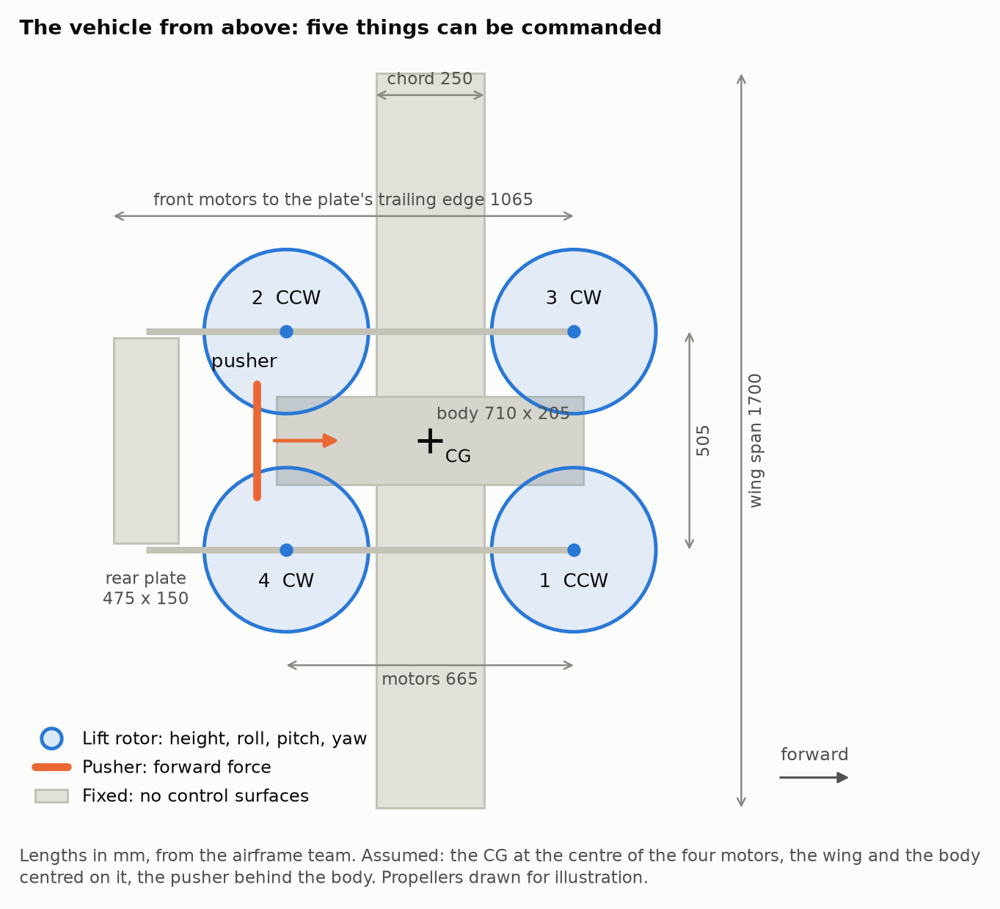

# 1. 기체

기체 수치는 [`vehicle/psi_qp.yaml`](../vehicle/psi_qp.yaml)에만 적습니다. 시뮬레이션의 Gazebo 모델과
PX4에 알려 주는 모터 위치가 모두 이 파일에서 만들어지므로, 값이 바뀌면 이 파일 하나만 고치면 됩니다.

## 제원

| 항목 | 값 | 출처 |
|---|---|---|
| 전비중량 | 7 kg | eCalc 계산의 기준 중량 |
| 주익 | NACA 4415, 스팬 1700 mm, 시위 250 mm, 1.5 kg | 동체팀 |
| 리프트 모터 4개 | 전후 665 mm × 좌우 505 mm 직사각형의 꼭짓점 | 동체팀 |
| 푸셔 1개 | 동체 뒤 | 위치와 사양 미정 |
| 뒤쪽 평판 | 475 × 150 mm, 붐 사이. 수직 꼬리 없음 | 동체팀 |
| 동체 | 710 × 205 × 215 mm | 동체팀 |
| 리프트 추력 대 중량비 | 1.9 | eCalc |
| 호버 시간 | 10.6분 | eCalc |

## 무엇으로 제어하는가

명령할 수 있는 것은 모터 다섯 개의 추력뿐입니다. 날개와 평판은 고정이고 조종면은 없습니다.

| 움직임 | 만드는 방법 | 비고 |
|---|---|---|
| 고도 | 리프트 로터 4개의 추력 합 | 정적 추력 대 중량비 약 1.9 |
| Roll | 좌우 리프트 로터의 추력 차 | |
| Pitch | 앞뒤 리프트 로터의 추력 차 | 날개·평판의 모멘트와 푸셔 오프셋도 이것으로 상쇄 |
| Yaw | 회전 방향이 다른 두 쌍의 반토크 차 | 가장 약한 축 |
| 전진 | 푸셔 추력 | 앞쪽으로만, 양의 추력만 |
| 감속 | 푸셔를 줄이고 기수를 들어 리프트 추력을 뒤로 기울임 | |
| 옆 이동 | 리프트 로터로 기체를 옆으로 기울임 | |

날개 양력은 직접 명령할 수 없고 속도와 받음각에 따라 정해집니다. 속도가 붙으면 날개가 무게의 일부를
들어 리프트 로터의 부담이 줄어듭니다. 그런데 날개가 너무 많이 들면 리프트 로터의 추력이 낮아져 자세를
잡을 여유도 줄어듭니다. 이 문제는 [제어 개념](02_control_concept.md#날개-양력과-제어-여유)에서 다룹니다.

## 수치의 출처

YAML의 값마다 아래 표시 중 하나를 붙여 두었습니다.

| 표시 | 뜻 | 해당하는 값 |
|---|---|---|
| GIVEN | 동체팀이 준 값 | 질량 7 kg, 날개 치수와 에어포일, 모터 위치, 평판·동체 치수 |
| DERIVED | GIVEN에서 계산한 값 | 리프트 최대 추력과 반토크(eCalc), 평판 위치 |
| ASSUMED | 자료가 올 때까지 쓰는 가정값 | 관성 모멘트, CG 위치(모터 네 개의 중심), 날개의 전후 위치와 붙임각, 푸셔 추력(25 N)과 위치, 평판 붙임각, 항력 계수 |
| MEASURED | 실제 기체나 벤치에서 측정한 값 | 아직 없음 |

eCalc는 계산 도구이므로 eCalc에서 나온 값도 측정값은 아닙니다. 동체팀에서 값이 확정되면 YAML의
값과 표시를 함께 바꿉니다.
