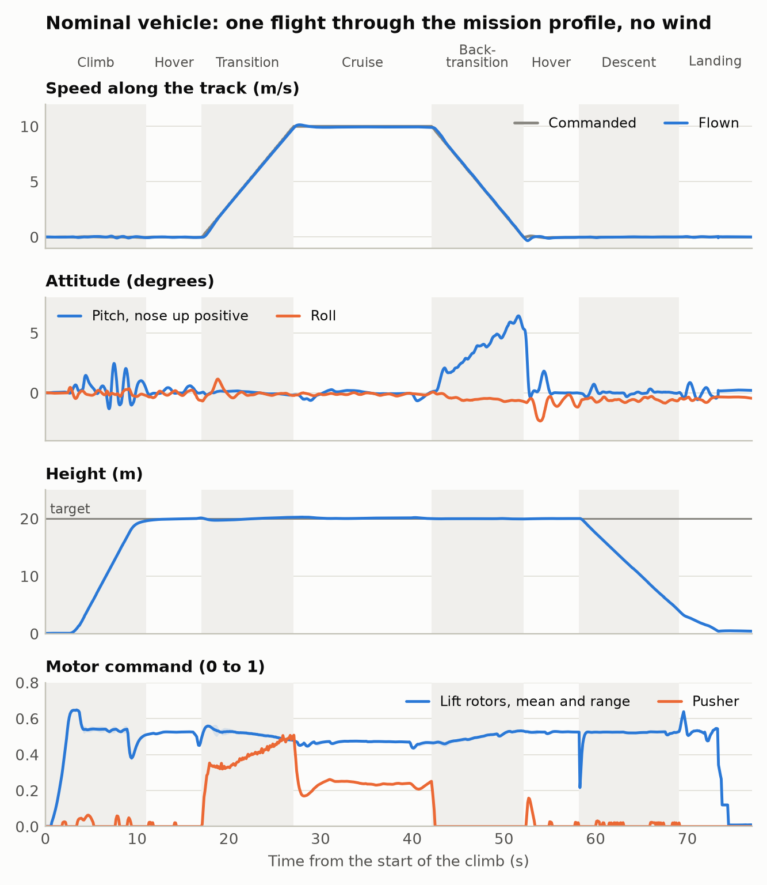
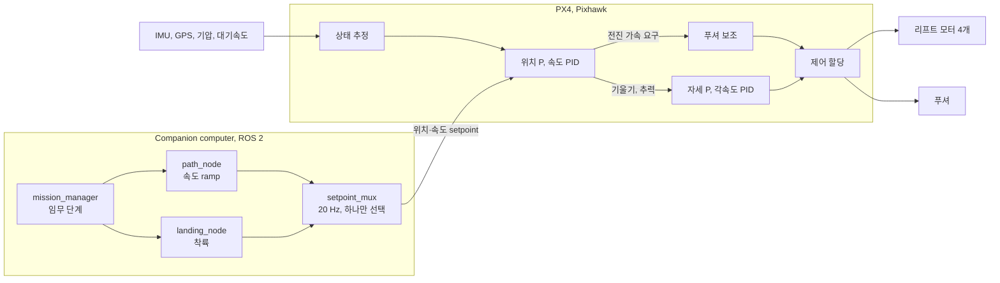

# 2. 제어 설계

시뮬레이션으로만 확인했고 실제 비행은 하지 않았습니다.

## 1. 임무

| 단계 | 내용 |
|---|---|
| 이륙, 상승 | 제자리에서 목표 고도까지 |
| 천이 | 호버에서 순항 속도까지 가속 |
| 수평 이동 | 순항 속도로 setpoint까지 |
| 역천이 | 착륙 지점 위에서 호버로 감속 |
| 하강, 착륙 | 제자리에서 지면까지 |

시뮬레이션에서 비행한 프로파일입니다. 고도 20 m, 순항 10 m/s, 가속 한계 1 m/s². 이 값들은
[`missions/2026_year_end/mission.yaml`](../missions/2026_year_end/mission.yaml)에 있습니다.

## 2. 제어 방법

이륙부터 착륙까지 멀티콥터로 비행합니다. 푸셔는 그 멀티콥터에 달린 다섯 번째 액추에이터로,
전진력만 냅니다. 날개는 얹혀 갑니다.

### 단계별 제어

| 단계 | 미션 노드가 보내는 setpoint | 리프트 로터 | 푸셔 |
|---|---|---|---|
| 이륙, 상승 | 이륙 지점 위치, 목표 고도 | 자세와 고도 | 꺼짐 |
| 천이 | 진행 방향 속도를 가속 한계로 올림, 고도 유지 | 자세와 고도 | 전진 가속 요구만큼 올라감 |
| 수평 이동 | 경로 방향 속도 또는 위치 | 무게에서 날개 양력을 뺀 만큼 | 항력만큼 유지 |
| 역천이 | 속도를 가속 한계로 내림, 이어서 착륙 지점 위치 | 기수를 들어 제동 | 0으로 |
| 하강 | 수직 속도, 위치 유지 | 전부 | 바람이 전진력을 요구할 때만 |
| 착륙 | PX4 Land 모드 | 전부 | 하강과 같음 |

### 제어 방법

- **기본은 PX4의 멀티콥터 PID 계단입니다.** 위치 P → 속도 PID → 자세 P → 각속도 PID → 할당.
  수정 없이 그대로 씁니다.
- **푸셔는 기수 숙임을 대신합니다.** 속도 루프가 전진 가속을 요구하면, PX4가 기체를 수평으로
  둔 채 그 요구를 푸셔 추력으로 바꿉니다(`VT_FWD_THRUST_EN`). 감속은 반대로, 푸셔를 0으로
  내리고 리프트 로터가 기수를 듭니다.
- **"천이"는 모드 전환이 아니라 속도 ramp입니다.** 명령 속도가 가속 한계를 지키며 올라가고,
  역천이에서는 같은 방식으로 내려갑니다.
- **고정익 모드는 쓰지 않습니다.** PX4의 고정익 모드는 리프트 로터를 끄고 조종면으로 자세를
  잡습니다. 조종면이 없는 이 기체에서는 제어를 잃습니다. 천이 명령은 절대 보내지 않습니다.

## 3. 구현

### 구성

- **PX4는 stock 그대로입니다.** 펌웨어 코드를 고치지 않고 파라미터만 설정합니다. 버전은
  v1.17.0으로 고정했습니다([`px4/README.md`](../px4/README.md)).
- **Companion은 어디로 갈지만 보냅니다.** 안정화는 전부 PX4가 합니다. 노드 구성은
  [4. 탑재 소프트웨어](04_onboard.md)에 있습니다.

### PX4 설정

Airframe은 standard VTOL(`CA_AIRFRAME 2`, `VT_TYPE 2`), 로터 5개, 서보 없음입니다. 시뮬레이션이
실제로 적용하는 값은 [`px4/params.yaml`](../px4/params.yaml)에 있고, 아래 표는 그 이유입니다.

| 파라미터 | 값 | 이유 | 값의 출처 |
|---|---|---|---|
| `CA_ROTOR_COUNT` | 5 | 리프트 4 + 푸셔 1 | 고정 |
| `CA_ROTOR0..3_PX`, `_PY` | CG 기준 ±0.3325, ±0.2525 m | 할당 기하 | 동체팀 치수. CG 위치는 확인 필요 |
| `CA_ROTOR4_AX`, `_AZ` | 1, 0 | 푸셔 추력이 앞을 향함 | 고정 |
| `CA_ROTOR4_PZ` | 0 | 추력선 오프셋은 pitch 적분기에 맡김 | 결정 |
| `CA_SV_CS_COUNT` | 0 | 조종면 없음 | 고정 |
| `VT_FWD_THRUST_EN` | 4 | 멀티콥터 모드에서 푸셔가 전진력을 냄 | 결정 |
| `VT_PITCH_MIN` | 0 | 기수를 숙이지 않음 | 결정 |
| `VT_FWD_THRUST_SC` | 무게 / 푸셔 최대 추력 | PX4가 요구한 가속도와 푸셔가 내는 가속도를 맞춤 | 푸셔 벤치 측정. 시뮬레이션 2.75 |
| `THR_MDL_FAC` | 추력 곡선 모양 | 명령과 추력을 비례하게 함 | 벤치 측정. eCalc로는 약 0.35 |
| `CA_R4_SLEW` | 1.0 s | 푸셔 명령이 0에서 최대까지 최소 1초 | 결정, 튜닝 대상 |
| `MC_YAWRATE_K` | 튜닝. 시뮬레이션 3 | 이 기체는 요 권한이 PX4 기본 모델의 약 1/3 | 호버 튜닝 |
| `MPC_XY_VEL_MAX` | 순항 속도보다 크게 | 아니면 PX4가 명령 속도를 자름 | 순항 속도 |
| `WV_EN` | 0 | 기수는 미션 노드가 명령 | 결정 |
| `SYS_HAS_NUM_ASPD` | 대기속도 센서 장착 시 1 | Arming 체크 | 하드웨어 |

### 미션 노드 규칙

- `setpoint_mux`를 거쳐 위치 또는 속도 setpoint만 보냅니다.
- 명령 속도는 가속 한계(시작값 1 m/s²)보다 빨리 바꾸지 않습니다. PX4는 offboard setpoint를
  smoothing 없이 쓰므로, setpoint의 계단은 곧 푸셔 명령의 계단입니다.
- 기수는 진행 방향으로 둡니다. 푸셔는 기수 방향으로만 밉니다.
- 순항 속도는 날개가 무게의 작은 부분만 드는 범위에 둡니다
  ([결과 보고서](../missions/2026_year_end/report.md)의 "알게 된 것").
- VTOL 천이 명령은 보내지 않습니다.

### PX4에서 천이를 명령할 수 있는 경로

세 군데이고 모두 막아야 합니다. v1.17.0 소스를 검색해 찾았고 전수 감사는 아닙니다.

- 명령 `VEHICLE_CMD_DO_VTOL_TRANSITION`: 노드가 보내지 않고, RC 천이 스위치를 매핑하지 않습니다.
- 미션과 VTOL 이륙 미션 항목: 미션을 올리지 않습니다.
- 미션 착륙을 따라가는 Return 모드: 미션이 없으면 멀티콥터로 곧장 돌아옵니다. `RTL_TYPE 0`으로
  명시합니다.

## 4. 질문과 답

**천이 때 푸셔를 점진적으로 올리면 제어가 더 안정한가**

네. 푸셔 추력이 천천히 변하면 추력선 오프셋 모멘트와 날개 양력 변화가 천천히 들어와서, 리프트
로터의 자세·고도 루프가 따라가기 쉽습니다. 두 가지로 구현합니다.

- 미션 노드가 명령 속도를 가속 한계 안에서 올립니다.
- `CA_R4_SLEW`가 푸셔 명령 자체의 변화율을 제한합니다(0에서 최대까지 최소 1초).

시뮬레이션에서 가속 한계를 0.5, 1, 2 m/s²로 바꾸면 푸셔 명령 최대가 0.39, 0.51, 0.81로,
제동 시 기수 들림이 3.7°, 6.4°, 18.2°로 커졌습니다.

**`VT_PITCH_MIN = 0`이면 수평 이동을 시작할 때 갑자기 켜지는가**

on/off가 아니라 비례입니다. 푸셔 명령은 속도 루프가 요구하는 전진 가속에 비례하고 0에서
시작합니다. 다만 가속 명령 자체가 처음부터 가속 한계 크기로 들어오므로, 천이 시작 직후 약
0.5초 만에 푸셔가 0.35까지 올라갑니다(1절 그림의 맨 아래). 이 구간에서 pitch는 ±0.2° 안에
머물렀습니다. 더 부드럽게 하려면 가속 한계를 낮추거나, 속도 명령의 시작을 S자로 다듬거나,
`CA_R4_SLEW`를 늘립니다.

기본값 -5°가 오히려 불연속입니다. 요구 pitch가 -5°를 넘는 순간 기수가 0°로 돌아가는데 푸셔는
그때 0에서 시작합니다.

**푸셔 추력선이 CG와 위아래로 어긋나면**

리프트 로터의 pitch 각속도 제어기 적분기가 흡수합니다. 오프셋 길이를 몰라도 되므로, 이론값과
실제가 달라도 상관없습니다. 시뮬레이션에서 ±6 cm 오프셋에 적분기는 한계 0.30 중 0.03–0.04를
썼고, CG ±4 cm는 0.12–0.16을 썼습니다. 줄이려면 배터리 높이를 옮기거나 푸셔 마운트를 기울여
추력선이 CG를 지나게 합니다. `CA_ROTOR4_PZ`로 할당에 넣는 방법은
[5. 해야 할 일과 향후 과제](05_roadmap.md)의 이유로 쓰지 않습니다.

**대기속도 센서**

Stock PX4는 멀티콥터 모드에서 대기속도를 제어에 쓰지 않습니다. 상태 추정의 대기속도 융합도
고정익 모드에서만 됩니다. 이 기체에서 쓸 곳은 속도 상한입니다. 날개 양력은 대기속도로 정해지고,
[결과 보고서](../missions/2026_year_end/report.md)의 "알게 된 것"처럼 날개가 무게의 큰 부분을
들면 제어 여유가 사라지기 때문입니다. 센서는 달되, 제어에 쓰는 것은 향후 과제의 첫 번째 확장으로
둡니다.
