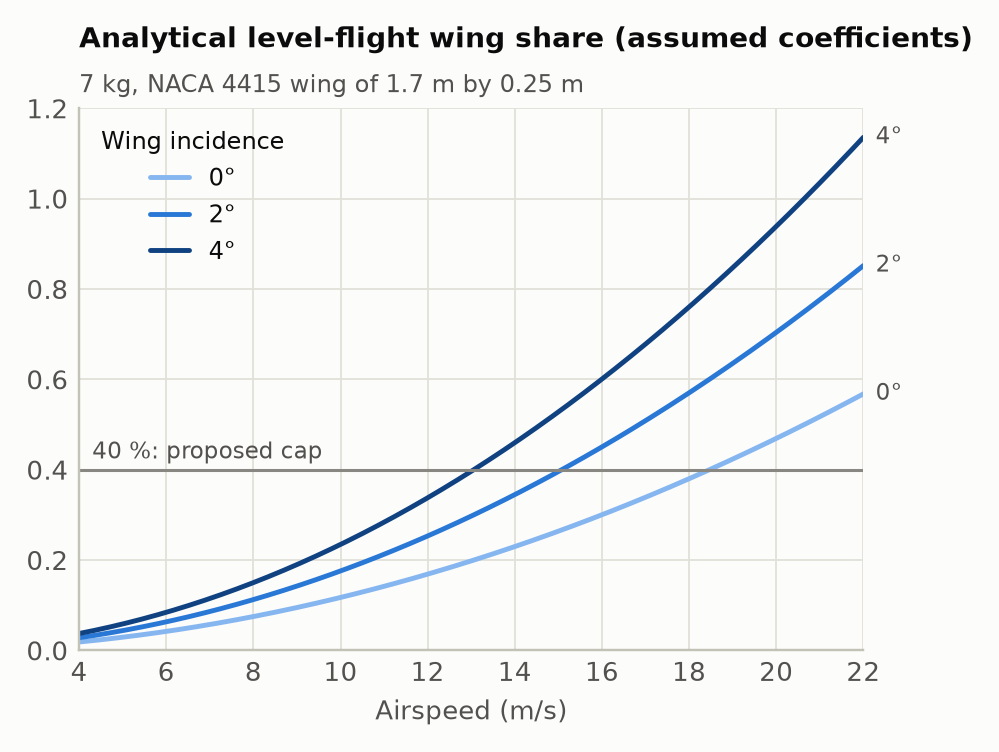

# 2. 제어 개념과 PX4 설정

이 기체는 리프트 모터 네 개로 고도와 자세를 잡고, 푸셔 한 개로 앞으로 가는 quadplane입니다. 비행
내내 PX4의 멀티콥터(MC) 제어를 쓰고, PX4 v1.17.0의 푸셔 보조 기능으로 전진력을 푸셔에 넘깁니다.
펌웨어는 수정하지 않고 파라미터만 바꿉니다.

조종면 없이 이렇게 나는 구성은 연구와 실내 저속 비행에서 사례가 있습니다
([6. 연구 배경](06_research_and_custom_px4.md)). 우리 기체로 야외 순항이나 측풍 비행을 해 본 적은
아직 없습니다.

## 1. 비행 순서

모든 단계에서 VTOL 상태는 MC입니다. 아래의 가속과 감속은 속도를 바꾸는 것일 뿐이고, PX4에 고정익
천이 명령을 보내지 않습니다.

| 단계 | Companion이 보내는 명령 | 다음 단계로 넘어가는 조건 | 시간 상한 |
|---|---|---|---|
| 상승 | 이륙 지점 x/y, 목표 고도 | 목표 고도 0.5 m 이내, 수직 속도 0.3 m/s 미만 | 60초 |
| 호버 | 같은 위치 | 호버 시간 경과 | 호버 시간 + 5초 |
| 가속 | 고도 유지, 전진 속도를 가속 한계로 증가 | ramp가 끝나고 실제 전진 속도가 목표의 ±10%(최소 ±0.5 m/s) 이내 | ramp 시간 + 5초 |
| 순항 | 고도와 전진 속도 유지 | 순항 시간 경과 | 순항 시간 + 5초 |
| 감속 | 전진 속도를 0까지 감소 | 수평 속도 0.5 m/s 미만 | ramp 시간 + 25초 |
| 두 번째 호버 | 감속이 끝난 위치 | 호버 시간 경과 | 호버 시간 + 5초 |
| 하강 | 같은 x/y에서 1.5 m/s로 하강 | 지면에서 4 m 아래 | 고도/1.5 + 20초 |
| 착륙 | PX4 Land 모드로 전환 | disarm | 60초 |

기본값은 고도 20 m, 순항 10 m/s, 가속 한계 1 m/s², 순항 15초, 호버 6초입니다. 값은
[`mission.yaml`](../missions/2026_year_end/mission.yaml)에, 순서와 조건은
[`profile.py`](../psi_vtol/profile.py)에 있습니다. 시뮬레이션과 ROS 2 노드가 같은 코드로 비행합니다.
시간 상한을 넘기면 그 단계는 실패로 끝납니다.

임무는 시간과 속도로만 정의되어 있고 목적지 좌표가 없습니다. 감속이 끝난 곳에 착륙하며, 착륙 오차도
그 지점을 기준으로 잽니다. 10 m/s에서 1 m/s²로 멈추려면 이상적으로도 50 m가 필요하고, 기본 임무는
가속·순항·감속을 합쳐 약 250 m를 갑니다. 시험장 크기에 맞춰 값을 정해야 합니다.

`heading_into_wind`를 1로 하면 기수를 대기 속도 방향으로 돌립니다(호버가 9초 늘어남). 평균풍을 알아야
하는 기능이라 시뮬레이션은 참 평균풍을 넘겨 줍니다. ROS 2 노드에는 아직 풍속 추정이 없으므로, 1로 두면
PATH 단계가 시작하자마자 이유를 밝히고 실패합니다. 기본값은 0입니다.

## 2. 제어 방법

### 역할 분담

Companion의 ROS 2 노드는 위치·속도·기수 setpoint만 만들고, `setpoint_mux`가 20 Hz로 PX4에 보냅니다.
상태 추정, 위치·속도 제어, 자세·각속도 제어, 모터 할당은 모두 PX4가 합니다. 축마다 어떤 모터를 쓰는지는
[1. 기체](01_vehicle.md#무엇으로-제어하는가)에 정리했습니다.

### 날개 양력과 제어 여유

간단한 수평 비행 근사에서 `리프트 추력 합 ≈ 무게 − 날개 양력`입니다. 날개가 무게를 많이 들수록
리프트 모터의 평균 추력이 내려가고, 자세 제어에 쓸 추력 차도 작아집니다.

yaw가 특히 그렇습니다. 모터 하나의 최대 추력을 Tmax, 네 모터의 추력 합을 T, 반토크 계수를 kQ라고
하면, 다른 축의 요구가 없을 때 낼 수 있는 yaw 모멘트는 `|Mz| ≤ kQ × min(T, 4Tmax − T)`입니다.
실제로는 roll·pitch 요구와 CG 보상이 이 여유를 나눠 쓰므로 더 작습니다. yaw 게인을 올려도 이 상한은
늘어나지 않습니다.



수평 비행에서 날개가 무게의 40%를 드는 대기속도는 붙임각 0°일 때 약 18 m/s, 4°일 때 약 13 m/s입니다.
제동할 때는 기수가 들려 받음각이 커지므로 같은 속도에서도 날개 부담이 훨씬 큽니다. 예를 들어 붙임각
0°, 10 m/s에서 수평이면 12%지만 기수를 6.4° 들면 31%가 됩니다. 그래서 순항에서 여유가 있어도 감속
중에 여유를 잃을 수 있습니다. 시뮬레이션 합격 기준의 40%는 시험을 시작하기 위해 정한 값이고, 이 값
아래면 안전하다는 근거는 없습니다.

### 푸셔 보조

PX4의 `pusher_assist()`는 앞으로 가려고 기수를 숙이라는 요구를 푸셔 명령으로 바꿉니다.
`VT_PITCH_MIN=0`으로 두면 보조가 켜진 동안에는 전진을 위해 기수를 숙이지 않고 푸셔만 씁니다. 그렇다고
pitch가 항상 0°인 것은 아닙니다. 제동할 때는 기수를 들고, 보조가 꺼지는 저고도와 Land 모드에서는
보통의 멀티콥터처럼 기울여서 이동합니다.

v1.17.0에서 푸셔 보조 명령은 0.9에서 잘립니다. 푸셔가 포화돼도 모자란 전진력을 기수 숙임으로 돌려
주지 않기 때문에, 푸셔가 약하거나 정풍이 강하면 목표 속도에 못 미칩니다
([`vtol_type.cpp`](https://github.com/PX4/PX4-Autopilot/blob/v1.17.0/src/modules/vtol_att_control/vtol_type.cpp)).

## 3. PX4 설정

### 3.1 버전과 기체 형식

- 펌웨어는 PX4 v1.17.0, ROS 메시지는 px4_msgs v1.17.0입니다([버전 표](../px4/README.md)).
- SITL은 airframe 4004 `gz_standard_vtol` 위에 우리 파라미터를 얹습니다. 4004는 Gazebo 전용이므로
  Pixhawk에는 쓰지 않습니다.
- 실기체는 standard VTOL을 바탕으로 별도 airframe 설정을 만듭니다. 출발점은 `CA_AIRFRAME=2`,
  `VT_TYPE=2`, 로터 5개, 조종면 0개입니다.
- 센서 방향과 보정, 출력 프로토콜, RC, 전원 모듈, 위치 센서는 QGroundControl에서 보드에 맞게
  설정합니다. 이 저장소의 수치로 정해지는 부분이 아닙니다.

### 3.2 모터 배치

PX4 좌표는 x 앞, y 오른쪽, z 아래(FRD)입니다. 아래 위치는 가정한 CG를 기준으로 한 값이므로 실제 CG를
재면 다시 계산해야 합니다.

| 모터 index / 출력 기능 | 위치 | PX4 x, y, z (m) | 추력축 AX, AY, AZ | KM |
|---|---|---|---|---|
| 0 / Motor 1 | 앞 오른쪽, CCW | +0.3325, +0.2525, −0.07 | 0, 0, −1 | +0.030 |
| 1 / Motor 2 | 뒤 왼쪽, CCW | −0.3325, −0.2525, −0.07 | 0, 0, −1 | +0.030 |
| 2 / Motor 3 | 앞 왼쪽, CW | +0.3325, −0.2525, −0.07 | 0, 0, −1 | −0.030 |
| 3 / Motor 4 | 뒤 오른쪽, CW | −0.3325, +0.2525, −0.07 | 0, 0, −1 | −0.030 |
| 4 / Motor 5 | 푸셔 | −0.40, 0, 0 | 1, 0, 0 | 0 |

- 회전 방향은 프로펠러를 추력이 나가는 쪽에서 내려다본 기준입니다.
- 모터 index는 보드의 커넥터 번호와 다릅니다. QGC Actuators에서 커넥터마다 Motor 1–5 기능을 지정하고,
  프로펠러를 뗀 상태로 모터 테스트를 돌려 위치와 회전 방향을 하나씩 확인합니다.
- 시뮬레이션에서 CG를 바꾸는 스윕은 Gazebo 모델만 바꾸고 PX4에는 위 기하를 그대로 알려 줍니다. PX4가
  모르는 CG 오차를 흉내 내려는 것입니다.

**`CA_ROTORn_CT=6.5`**: 다섯 모터에 똑같이 준 할당기의 상대 계수이고 N 단위 추력이 아닙니다. PX4
v1.17은 효과 행렬의 한 행이 모두 절댓값 0.05 이하면 그 축을 아예 지웁니다
([`ControlAllocator.cpp`](https://github.com/PX4/PX4-Autopilot/blob/v1.17.0/src/modules/control_allocator/ControlAllocator.cpp)).
CT=1, |KM|=0.03에서는 실제로 SITL에서 yaw 행이 지워졌습니다. 공통 배율을 6.5로 올리면 yaw 계수가
0.195가 되어 이 문턱을 넘습니다. 할당은 정규화되므로 이 배율이 물리적인 추력이나 반토크를 바꾸지는
않습니다([`ControlAllocationPseudoInverse.cpp`](https://github.com/PX4/PX4-Autopilot/blob/v1.17.0/src/lib/control_allocation/control_allocation/ControlAllocationPseudoInverse.cpp)).

**KM과 푸셔 오프셋**: KM은 부호를 포함한 반토크/추력 비이고 지금 값은 eCalc에서 계산한 것입니다. stock
standard-VTOL 할당기는 수평 로터(푸셔)의 반토크를 쓰지 않고, 푸셔의 PY/PZ도 0으로 두었습니다. 그래서
푸셔의 roll 반토크와 추력선 오프셋은 리프트 쪽 자세 제어가 외란으로 받아서 상쇄합니다. 오프셋이 크면
적분기와 모터가 포화할 수 있으므로 실제 추력선 위치는 재 두어야 합니다.

### 3.3 파라미터

원본은 [`px4/params.yaml`](../px4/params.yaml)이고 `concept`, `per_vehicle`, `sim_only` 세 묶음으로
나뉩니다. `sim_only`는 RC와 데이터 링크 failsafe를 끄는 값이므로 **실기체에는 절대 올리지 않습니다.**

| 설정 | 값 | 의미 |
|---|---|---|
| `CA_ROTOR_COUNT`, `CA_SV_CS_COUNT` | 5, 0 | 모터 5개, 조종면 없음 |
| `VT_FWD_THRUST_EN` | 5 | `MPC_LAND_ALT1` 위에서만 푸셔 보조. auto Land와 하강에서는 끔 |
| `VT_PITCH_MIN` | 0° | 보조가 켜진 동안 전진을 위해 기수를 숙이지 않음 |
| `VT_LND_PITCH_MIN` | 0° | Land 중 같은 설정. mode 5에서는 Land 중 보조가 꺼지므로 명시만 해 둔 값 |
| `VT_FWD_THRUST_SC` | 2.75 | 무게/푸셔 최대 추력에서 시작한 값. 푸셔 벤치 시험 후 다시 정함 |
| `CA_R4_SLEW` | 1.0 s | 푸셔 명령이 0→1로 가는 데 최소 1초 |
| `CA_ROTOR4_PY`, `_PZ` | 0, 0 | 푸셔 오프셋을 할당에 넣지 않음 |
| `THR_MDL_FAC` | 1.0 | 시뮬레이터의 정적 추력이 회전수 제곱이라 1. 실기체는 벤치 곡선으로 정함(eCalc로는 약 0.35) |
| `MC_YAWRATE_K` | 3.0 | 이전 모델에서 맞춘 SITL 값. 새 모델과 실기체에서 다시 맞춰야 함 |
| `MPC_XY_VEL_MAX` | 16 m/s | 명령 속도가 잘리지 않도록 둔 상한. 운용 속도가 아님 |
| `WV_EN` | 0 | 기수는 미션 노드가 정함 |
| `RTL_TYPE` | 0 | 직접 귀환. 실제 failsafe 경로는 따로 시험 |

`VT_FWD_THRUST_EN=5`의 고도 판단에는 거리 센서나 home 기준 고도가 쓰입니다. 경계에 hysteresis가
없어서 그 근처에서는 보조가 켜졌다 꺼졌다 할 수 있으므로 `MPC_LAND_ALT1`의 실효값을 확인해 둡니다.
모드 번호의 정의는 [`vtol_type.h`](https://github.com/PX4/PX4-Autopilot/blob/v1.17.0/src/modules/vtol_att_control/vtol_type.h)에
있습니다.

### 3.4 검토용 파라미터 파일 만들기

```bash
bash simulation/docker_run.sh python3 -m psi_vtol.px4_setup --output /workspace/out/psi_candidate.params
```

QGC 형식 파일이 만들어집니다. 모터 기하와 `concept`, `per_vehicle`이 들어가고 `sim_only`는 빠집니다.
출력 핀, 센서 보정, RC, failsafe는 들어 있지 않습니다. 추력·CG·게인이 아직 가정값이므로, 측정한 값으로
원본 YAML을 고친 뒤 다시 만들어서 QGC에서 기존 설정과 비교하고 적용합니다.

### 3.5 실기체에서 따로 확인할 것

- Offboard 상실 시 동작: `COM_OF_LOSS_T`, `COM_OBL_RC_ACT`, RC가 있을 때와 없을 때.
- RC, 데이터 링크, 배터리, 지오펜스, 위치 추정을 잃었을 때의 동작.
- `MPC_LAND_ALT1/2`, `MPC_LAND_SPEED`, `COM_DISARM_LAND`와 지면 기준 고도.
- 대기속도 센서를 달았다면 방향, 보정, 유효성. 지금은 PX4도 미션 노드도 대기속도로 속도를 제한하지
  않습니다.

PX4는 offboard에 들어가기 전에 setpoint 스트림을 요구하고, 스트림이 끊기면 설정된 loss 동작을 합니다
([Offboard 문서](https://docs.px4.io/v1.17/en/flight_modes/offboard)). ROS 노드의 watchdog은
스트림을 멈출 뿐이고, 그다음은 PX4의 failsafe 설정에 달려 있습니다.

### 3.6 고정익 천이 막기

조종면이 없으므로 고정익 모드로 들어가면 자세를 잡을 수단이 없습니다. 그래서 다음을 지킵니다.

- 노드는 `VEHICLE_CMD_DO_VTOL_TRANSITION`을 보내지 않습니다.
- RC에 천이 스위치를 매핑하지 않습니다.
- VTOL 이륙, 천이, 고정익 미션 항목을 올리지 않습니다.

Return, geofence, link loss, 수동 모드 전환에서도 MC가 유지되고 리프트 모터가 계속 도는지 SITL 로그로
하나씩 확인합니다. `VT_FW_DIFTHR_EN`을 켜는 것만으로는 이 기체에 맞는 고정익 제어가 되지 않습니다.

## 4. 시험 순서

1. 공력 플러그인 빌드, 단위 시험, 무풍 nominal SITL
2. OAT 스윕, 양쪽 측풍
3. 조건을 겹친 corner 시험: 약한 푸셔 + 정풍, 높은 양력 + 제동, 저전압 + 로터 손실
4. ROS 2 노드로 같은 시험, 그리고 노드 종료·토픽 단절·offboard 상실 주입
5. 실측한 질량·CG·관성·추력 곡선을 반영한 뒤 구속 호버와 저속 푸셔 비행부터 비교

custom PX4를 언제, 어떤 순서로 만들지는 [6. 연구 배경과 custom PX4](06_research_and_custom_px4.md)에
정리했습니다.
