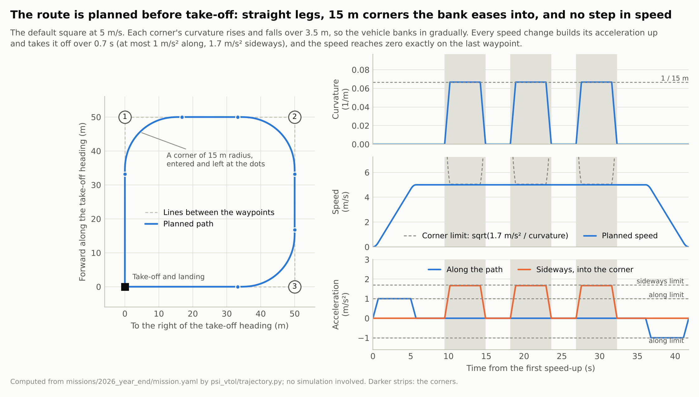

# 2. 비행 방법

리프트 모터 네 개로 고도와 자세를 잡고, 푸셔 하나로 앞으로 갑니다. 이륙부터 착륙까지 PX4의 멀티콥터(MC)
제어로 날고, PX4의 푸셔 보조가 전진력을 푸셔에 넘깁니다. 고정익 천이는 하지 않습니다. PX4는 수정하지 않고
파라미터만 바꿉니다([3. PX4 설정](03_px4_setup.md)).

Jetson의 노드는 "어디로 얼마나 빨리"(위치·속도·가속도·기수 setpoint)만 정하고, 상태 추정, 위치·속도 제어,
자세 제어, 모터 할당은 PX4가 합니다. 축마다 어떤 모터를 쓰는지는 [1. 기체](01_vehicle.md#무엇으로-제어하는가)에
있습니다. 비행 순서와 고장 판단은 `psi_vtol/profile.py` 한 곳에 있고, 시뮬레이션과 ROS 2 노드가 함께 씁니다.

## 1. 임무

기본 임무는 **한 변 50 m 정사각형**을 5 m/s로 오른쪽으로 돌아 이륙 지점에 착륙하는 것입니다. 경로는
`mission.yaml`의 `route_m`에 경유점 `[앞, 왼쪽]`(m, 이륙 지점 기준)으로 적습니다. 경로를 나는 방법은 두
가지입니다.

- **통과 비행(`fly_through: 1`, 기본값).** 모서리에서 멈추지 않고 반경 15 m 곡선으로 돕니다. 비행기처럼
  기체를 옆으로 약 10° 기울여 돌고 기수는 경로를 따라갑니다. 기울임은 리프트 모터가 만듭니다. 경유점에서
  약 6 m 안쪽을 지나갑니다.
- **멈춰서 돌기(`fly_through: 0`).** 경유점마다 정확히 멈추고, 호버하면서 기수를 다음 방향으로 돌립니다.
  120°보다 급한 모서리(갔다가 돌아오기의 180°)는 통과 비행에서도 이렇게 돕니다.

SITL에서 5 m/s 정사각형은 통과 비행으로 42초, 멈춰서 돌기로 100초 걸렸습니다
([보고서 2절](../missions/2026_year_end/report.md#2-경로와-속도)).

| 단계 | Companion이 보내는 명령 | 다음 단계로 넘어가는 조건 | 시간 상한 |
|---|---|---|---|
| 상승 | 이륙 지점 x/y, 목표 고도 | 목표 고도 0.5 m 이내, 수직 속도 0.3 m/s 미만 | 60초 |
| 호버 | 같은 위치 | 호버 시간 경과 | 호버 시간 + 5초 |
| 회전 *(멈춰서 돌 때, 방향이 바뀌면)* | 경유점 위 호버, 기수를 다음 구간 방향으로 20°/s | 기수가 실제로 3° 안에 들어와 1초 | 회전 시간 + 17초 |
| 가속, 순항, 감속, 모서리 | 기준점의 속도(기준점 쪽으로 보정), 가속도, 고도, 기수, yaw 속도 | 계획된 시간이 지남 | 계획 시간 + 15초 |
| 경유점 호버 | 경유점 위치 | 호버 시간 경과, 경유점 1 m 이내 | 호버 시간 + 15초 |
| 정렬 | 착륙 지점 위, 기수를 바람 쪽으로 | 0.3 m 안, 0.2 m/s 미만, 바람을 마주 봄, 2초 유지 | 45초 |
| 하강 | 착륙 지점 위에서 1.5 m/s로 하강 | 지면에서 4 m 아래 | 고도/1.5 + 20초 |
| 착륙 | PX4 Land 모드로 전환 | disarm | 60초 |

기본값은 고도 20 m, 순항 5 m/s, 가속 한계 1 m/s², 호버 6초, 모서리 반경 15 m, 옆 가속도 1.7 m/s²입니다. 값은
[`mission.yaml`](../missions/2026_year_end/mission.yaml)에 있고, 단계의 흐름은
[0. 전체 구조](00_architecture.md#4-임무의-흐름)에 그림으로 있습니다.

- **고도는 6 m 이상.** PX4가 5 m 아래에서 푸셔 보조를 끄므로([7절](#7-푸셔-보조)) 프로파일이 더 낮은 고도를
  거부합니다.
- **경로의 방향.** 기본으로는 이륙할 때 기체가 바라보는 방향이 경로의 "앞"입니다. `route_heading_deg`(0–359)를
  주면 그 방위가 "앞"이 되어, 기체를 어느 쪽으로 내려놓든 계획한 자리에 정사각형을 그립니다.
- 경유점은 이륙 지점 기준의 상대 좌표입니다. GPS 좌표 목적지와 장애물 회피는 없으므로 시험장 크기에 맞춰
  경로를 정합니다. 지오펜스는 경로에서 계산됩니다([3. PX4 설정](03_px4_setup.md#4-파라미터)).

## 2. 경로 계획

이륙하기 전에 경로 전체와 그 위의 속도를 계산해 두고(`psi_vtol/trajectory.py`), 비행 중에는 시간에 따라 읽기만
합니다.

1. **경로(`Path`).** 경유점 사이는 직선이고, 모서리는 곡률이 0에서 1/반경까지 일정하게 늘었다가 원호로
   유지되고 다시 0으로 줄어드는 곡선(clothoid–원호–clothoid)입니다. 전이 구간의 길이는 순항 속도 × 0.7초입니다.
   곡률이 계단처럼 바뀌지 않으므로 옆 기울기도 서서히 바뀝니다. 두 모서리의 곡선이 짧은 구간 안에서 겹치면
   반경을 줄입니다(최소 5 m).
2. **속도(`SpeedPlan`).** 직선의 상한은 순항 속도, 모서리는 옆 가속도 1.7 m/s²를 넘지 않는 √(1.7 / 곡률)입니다.
   처음과 끝은 0 m/s입니다. 구간 경계의 속도를 앞뒤로 훑어 이웃 직선이 가속 한계로 낼 수 있는 속도로 낮춘 뒤,
   직선마다 가속하고 감속합니다. 속도를 바꿀 때는 가속도를 0.7초에 걸쳐 키우고 줄입니다(`SpeedRamp`). 그래서
   속도는 마지막 경유점에서 정확히 0이 됩니다.
3. **따라가기(`Profile`).** 매 순간 기준점의 위치, 속도, 진행 방향 가속도와 곡률을 읽어 setpoint를 만듭니다.
   가속도에는 모서리 안쪽으로 속도² × 곡률을 더하고, 기수는 경로 방향, yaw 속도는 속도 × 곡률입니다.

가속도가 계단처럼 바뀌면 PX4의 기울기 setpoint도 계단처럼 바뀝니다. 그렇게 했을 때 SITL에서 감속 시작에
푸셔가 0.2초 만에 꺼지고 기수가 7.2°까지 튀었습니다. 지금은 5 m/s에서 멈추는 데 14.3 m, 5.7초가 걸립니다.
반경 15 m 모서리는 5 m/s로 돌 수 있으므로, 50 m 정사각형에서는 순항을 5 m/s보다 높여도 거의 빨라지지
않습니다.

## 3. PX4에 보내는 것

기체가 움직이는 기준점을 따라가므로, 기준점이 경유점에 멈추면 기체도 거기서 멈춥니다. SITL에서 멈춰서 돌기는
모든 경유점의 0.05 m 안에 멈췄습니다.

움직이는 동안에는 기준점의 수평 위치를 보내지 않습니다. 기준점의 속도에, 기체가 벗어난 만큼 되돌아가는 성분
(0.8/s, PX4의 `MPC_XY_P`와 같은 값, 최대 2 m/s)을 더해 속도로 보냅니다(`profile.for_px4`). Jetson이 멈추면 PX4는
마지막 setpoint를 1초 더 따르는데(`COM_OF_LOSS_T`), 거기에 위치가 있으면 이미 지나친 점으로 돌아가려고 기수를
29° 들었습니다(SITL, 5 m/s). 속도만 있으면 그대로 가다가 PX4의 Hold에서 12°로 멈춥니다. 호버처럼 멈춰 있는
setpoint는 위치를 그대로 보냅니다.

## 4. 착륙

마지막 경유점 위에서 0.3 m 안, 0.2 m/s 미만으로 2초 머문 뒤에 내려갑니다. 그동안 기수를 바람 쪽으로 돌립니다.
대기속도 센서가 없으므로 PX4의 weathervane과 같은 원리를 씁니다. 제자리를 지키려는 기체는 바람 쪽으로
기울어 있으므로, 옆으로 기울어 있으면 그쪽으로 돌고(1°당 약 1°/s, 최대 15°/s), 옆 기울기 없이 기수가 들려
있으면 뒤바람이므로 돌아섭니다. 앞바람은 푸셔가 받아 내므로 그대로 둡니다. 25초 안에 끝나지 않아도 1 m
안이면 내려갑니다. 4 m 아래에서는 PX4의 Land 모드가 0.5 m/s로 내려앉힙니다.

## 5. 고장 대응

프로파일은 위치와 속도로 앞으로 갈 수 없는 상황을 알아챕니다.

- **푸셔가 없음.** 가속을 시작하고 3초가 지나도 앞으로 0.5 m/s 미만이거나, 계획보다 1.5 m/s 넘게 느리고 2초
  전보다 0.5 m/s 더 뒤처졌는데 그동안 스스로는 속도를 얻지 못하면 푸셔 고장입니다. 7 m/s 정사각형에서는
  가속·모서리·감속이 1.4초마다 바뀌므로 계획의 단계와 상관없이 봅니다.
- **크게 뒤처짐.** 기준점보다 8 m 넘게 뒤처지면 푸셔가 약하거나 정풍에 다 쓰인 것입니다.

어느 쪽이든 앞으로 갈 수 없으므로 **멈춘 뒤 그 자리에 착륙합니다**(`profile.needs_land`). 그 밖의 중단(단계 시간
초과, 운용자의 중단, 응답 없는 노드)은 **멈춘 뒤 PX4의 Hold**에 넘깁니다. 조종사나 PX4의 failsafe가 이미 기체를
가져갔으면 손대지 않습니다.

멈출 때는 들어가는 순간의 위치를 목표로 고정하지 않고, 가던 방향으로 1.5 m/s²까지(0.5초에 걸쳐 키우고 줄임)
감속해 멈춘 곳을 지킵니다(`profile.Stop`). 5 m/s에서 9.6 m, 3.8초가 걸립니다. 들어가는 순간의 위치를 목표로
고정했을 때는 지나친 점으로 돌아가려고 SITL에서 48°까지 기울었습니다.

푸셔가 죽은 기체를 Hold에 두면 안 됩니다. Hold에서도 푸셔 보조가 켜져 있어 PX4가 기수를 숙이지 못하고 죽은
푸셔만 최대로 돌리며 버팁니다. 15초 뒤 Land로 바꾸자 그동안 쌓인 명령이 한꺼번에 나와 기수가 −45°에서
+48°까지 흔들렸습니다(SITL). Land는 푸셔 보조를 끄므로 기체가 기울여 제자리를 지키며 내려옵니다.

노드와 토픽, watchdog은 [5. 탑재 소프트웨어](05_onboard.md#문제가-생겼을-때)에, SITL에서 고장을 일으켜 본 결과는
[보고서 4절](../missions/2026_year_end/report.md#4-고장)에 있습니다.

## 6. 날개 양력과 제어 여유

수평 비행에서 `리프트 추력 합 ≈ 무게 − 날개 양력`입니다. 날개가 무게를 많이 들수록 리프트 모터의 추력이
내려가고, 자세 제어에 쓸 추력 차도 작아집니다.

yaw가 특히 그렇습니다. 모터 하나의 최대 추력을 Tmax, 네 모터의 추력 합을 T, 반토크 계수를 kQ라고 하면 낼 수
있는 yaw 모멘트는 `|Mz| ≤ kQ × min(T, 4Tmax − T)`입니다. 실제로는 roll·pitch 요구와 CG 보상이 이 여유를 나눠
쓰므로 더 작습니다. yaw 게인을 올려도 이 상한은 늘어나지 않습니다.

날개가 무게의 40%를 드는 대기속도는 붙임각 0°일 때 약 18 m/s, 4°일 때 약 13 m/s입니다. 제동할 때는 기수가
들려 받음각이 커지므로 같은 속도에서도 날개 부담이 훨씬 큽니다(붙임각 0°, 10 m/s에서 수평이면 12%, 기수를
6.4° 들면 31%). 시뮬레이션 합격 기준의 40%는 시험을 시작하려고 정한 값이고, 그 아래면 안전하다는 근거는
없습니다.

## 7. 푸셔 보조

PX4의 `pusher_assist()`는 앞으로 가려고 기수를 숙이라는 요구를 푸셔 명령으로 바꿉니다. `VT_PITCH_MIN=0`이면
보조가 켜진 동안 전진을 위해 기수를 숙이지 않고 푸셔만 씁니다. 제동할 때는 기수를 들고, 보조가 꺼지는 5 m
아래와 Land 모드에서는 보통의 멀티콥터처럼 기울여 이동합니다. 푸셔 보조 명령은 0.9에서 잘리고, 모자란
전진력을 기수 숙임으로 돌려 주지 않습니다
([`vtol_type.cpp`](https://github.com/PX4/PX4-Autopilot/blob/v1.17.0/src/modules/vtol_att_control/vtol_type.cpp)).
그래서 푸셔가 약하거나 정풍이 강하면 목표 속도에 못 미칩니다.

**푸셔가 고장 나면** 보조가 켜진 모드(Offboard, Position, Altitude, Hold, Return)에서는 앞으로 가지 못합니다.
SITL에서 푸셔를 끈 채 날면 첫 가속에서 그 자리에 멈춰 있었고, `VT_FWD_THRUST_EN=0`으로 보조를 끄자 일반
쿼드처럼 기수를 2.6° 숙여 정사각형 전체를 5 m/s로 날았습니다. 노드는 이 파라미터를 바꿀 수 없으므로 고장을
알아채면 Land에 넘깁니다([5절](#5-고장-대응)). **조종자가 직접 데려오려면 QGC에서 `VT_FWD_THRUST_EN=0`으로
바꾸거나 Stabilized 모드로 비행합니다. Position 모드로는 스틱을 밀어도 앞으로 가지 않습니다.**
