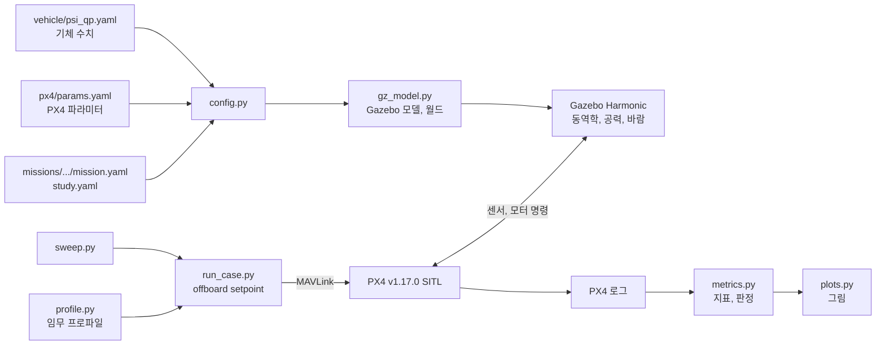

# 3. 시뮬레이션: Gazebo SITL

## 1. 방법



- 실제 PX4 펌웨어가 Gazebo 안의 기체를 비행시킵니다. 제어기를 따로 흉내 내지 않습니다.
- setpoint는 ROS 2 노드가 보내는 것과 같은 offboard 위치·속도 setpoint입니다. 둘 다
  `psi_vtol/profile.py`에서 만듭니다.
- 이륙부터 착륙까지 프로파일 전체를 비행하고, PX4 로그에서 지표를 뽑습니다.
- 통과 기준: 프로파일 완료, roll·pitch 30° 미만, 고도 오차 3 m 미만, 리프트 모터가 최대치에
  머문 시간 5% 미만, 할당기가 요구 토크를 못 낸 시간 10% 미만. `psi_vtol/sim/metrics.py`의
  `LIMITS`입니다.

## 2. 준비

WSL(Ubuntu)에서 실행합니다. 확인한 환경은 Ubuntu 24.04, Python 3.12, Gazebo Harmonic(gz sim 8),
PX4 v1.17.0입니다.

```bash
git clone --recursive -b v1.17.0 https://github.com/PX4/PX4-Autopilot.git ~/px4-v1.17.0
```

```bash
bash ~/px4-v1.17.0/Tools/setup/ubuntu.sh
```

```bash
make -C ~/px4-v1.17.0 px4_sitl_default
```

이 repo는 최상위에서 실행하면 설치 없이 돕니다. 필요한 Python 패키지는 `pyproject.toml`에
적혀 있습니다(pymavlink, pyulog, pyyaml, numpy, matplotlib, 시험용 pytest). 가상환경에 한 번에
설치하려면 다음과 같이 합니다. Ubuntu에서는 `python3-venv` 패키지가 먼저 필요합니다.

```bash
python3 -m venv .venv && source .venv/bin/activate && pip install -e ".[dev]"
```

PX4를 다른 곳에 빌드했으면 `PSI_PX4_ROOT`로, 실행 파일을 둘 곳을 바꾸려면 `PSI_RUN_ROOT`(기본
`/tmp/psi_qp_runs`)로 알려 줍니다.

## 3. 실행

repo 최상위에서 실행합니다.

```bash
python3 -m psi_vtol.sim.run_case                 # 기준 기체 한 번 (1–2분)
python3 -m psi_vtol.sim.sweep oat --jobs 4       # 값을 하나씩
python3 -m psi_vtol.sim.sweep wind --jobs 4      # 바람 속도와 방향
python3 -m psi_vtol.sim.sweep random --n 40      # 전부 동시에
python3 -m psi_vtol.plots                        # 그림
```

- 값 하나만 바꿔 보려면 `--set mass_kg=7.5`, PX4 파라미터는 `--px4 MC_YAWRATE_K=2`.
- 스윕 결과표는 `out/<미션>/`에(git에 올리지 않음), 그림은 `missions/<미션>/figures/`에 생깁니다.
- PX4 없이 도는 단위 시험은 `python3 -m pytest`입니다.

## 4. 기체 모델

[`vehicle/psi_qp.yaml`](../vehicle/psi_qp.yaml)에 값마다 출처를 적었습니다. 실제 기체에서 측정한
값은 없습니다.

- **받은 값**: 질량 7 kg, 날개 치수와 에어포일, 모터 위치, 평판 치수, 동체 치수.
- **받은 값에서 계산한 값**: 리프트 최대 추력과 프로펠러 반토크(eCalc), 평판 위치.
- **가정한 값**: 관성 모멘트, CG가 모터 네 개의 중심에 있다는 것, 날개의 전후 위치와 붙임각,
  푸셔의 추력(25 N)과 위치, 평판 붙임각, 항력 계수.

통과는 "이런 기체에서 이 제어 개념이 성립한다"는 뜻이지, 실제 기체의 검증이 아닙니다.

결과는 [`missions/2026_year_end/report.md`](../missions/2026_year_end/report.md)에 있습니다.

## 5. ROS 2 노드로 비행시키기

`run_case.py` 대신 실제 미션 노드가 같은 프로파일을 비행합니다. 터미널 세 개를 씁니다.
준비는 [4. 탑재 소프트웨어](04_onboard.md)에 있습니다.

```bash
python3 -m psi_vtol.sim.start
```

```bash
MicroXRCEAgent udp4 -p 8888
```

```bash
ros2 launch vtol_mission mission.launch.py auto_arm:=true
```

`PX4 is up`이 뜬 뒤 임무를 시작합니다.

```bash
ros2 topic pub --once /mission/start std_msgs/msg/String "{data: START}"
```
