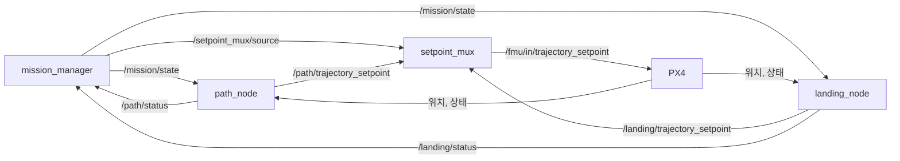

# 4. 탑재 소프트웨어 (ROS 2)

Companion computer에서 도는 미션 노드입니다. 패키지는 `ros2/ws/src/vtol_mission` 하나입니다.

## 1. 구성



| 노드 | 파일 | 하는 일 |
|---|---|---|
| `mission_manager` | `mission_manager.py` | 임무를 단계 목록 순서대로 진행합니다. `WAIT_START → PATH → LANDING → MISSION_DONE`, 문제가 생기면 어디서든 `FAILSAFE` |
| `setpoint_mux` | `setpoint_mux.py` | 지금 단계의 setpoint만 PX4로 보냅니다. PX4에 setpoint를 보내는 노드는 이것 하나입니다 |
| `path_node` | `path_node.py` | 단계 `PATH`: 상승, 호버, 그리고 경로의 경유점마다 회전–가속–순항–감속–호버. 천이 명령은 보내지 않습니다 |
| `landing_node` | `landing_node.py` | 단계 `LANDING`: 마지막 경유점(기본은 이륙 지점) 위에서 하강하다가 4 m 아래에서 PX4 Land 모드에 넘깁니다 |

`path_node`와 `landing_node`의 setpoint는 `psi_vtol/profile.py`가 만듭니다. 시뮬레이션이 비행한 것과
같은 코드이고, 고도·속도·가속 한계·경로는
[`missions/2026_year_end/mission.yaml`](../missions/2026_year_end/mission.yaml)에서 읽습니다. 전체 흐름은
[0. 전체 구조](00_architecture.md#3-탑재-비행-소프트웨어)에 그림으로 있습니다.

### 단계 노드의 규칙

단계 하나가 노드 하나이고, 모두 `source.py`의 `SetpointSource`를 상속해 같은 규칙을 따릅니다.

| 방향 | 토픽 | 내용 |
|---|---|---|
| 받음 | `/mission/state` | 값이 자기 단계 이름과 같을 때만 동작 |
| 보냄 | `/<단계>/trajectory_setpoint` | setpoint. `setpoint_mux`가 PX4로 전달 |
| 보냄 | `/<단계>/status` | `ACTIVE:<상태>`, `DONE`, `FAILED:<이유>` |

새 단계를 넣으려면 `SetpointSource`를 상속한 노드를 만들고 `launch/mission.launch.py`의 `STEPS`에 이름을
추가합니다. `mission_manager`와 `setpoint_mux`는 고칠 필요가 없습니다. vision 정밀 착륙도 이렇게
`LANDING` 자리에 들어갈 예정입니다([5. 할 일](05_roadmap.md#3-vision-vtol로-가는-길)).

### 문제가 생겼을 때

| 상황 | 동작 |
|---|---|
| 단계가 `FAILED`를 보고하거나 `/mission/abort`에 `ABORT` 수신 | mission_manager가 `FAILSAFE`로 가고, mux가 기체를 부드럽게 멈춤(HOLD). 6초 뒤 아직 offboard면 PX4에 넘김: 앞으로 갈 수 없는 고장(`psi_vtol.profile.needs_land`: 푸셔 고장, 크게 뒤처짐)이면 Land, 아니면 Hold |
| 앞으로 나가지 못함(가속 3초 뒤 0.5 m/s 미만) 또는 계획보다 1.5 m/s 넘게 느린 채 속도를 얻지 못함 | PATH가 `FAILED:pusher: no forward speed ...` 또는 `FAILED:pusher: not speeding up ...`. 위처럼 멈춘 뒤 그 자리에 착륙 |
| 기준점보다 8 m 넘게 뒤처짐 | PATH가 `FAILED:falling behind the route ...`. 앞으로 갈 수 없다는 뜻이므로 역시 멈춘 뒤 착륙 |
| 단계 노드의 status가 2초 동안 오지 않음 | `FAILSAFE` |
| 조종사나 PX4 failsafe가 offboard에서 빼냄 | 노드가 `FAILED:left offboard in <단계>`를 보고. 그 뒤는 조종사와 PX4가 맡음 |
| 단계가 시간 상한을 넘김 | `FAILED:timeout in <단계>` |
| 단계 노드가 받는 PX4 위치·상태가 1초 넘게 끊기거나 유효하지 않음 | `FAILED:PX4 state telemetry stale`. 다른 단계가 선택될 때까지 유지 |
| 선택된 단계의 setpoint가 0.5초 넘게 끊김 | mux가 HOLD(부드럽게 멈춤) |
| mux가 받는 위치가 1초 넘게 끊기거나 유효하지 않음 | mux가 offboard 스트림을 멈춤. 이후 PX4의 `COM_OF_LOSS_T`와 loss 동작이 적용됨 |

HOLD는 기체를 그 자리에 세웁니다. 들어가는 순간의 위치를 목표로 고정하지 않고, 지금 가던 방향으로
1.5 m/s²까지(0.5초에 걸쳐 키우고 줄임) 감속해 멈춘 곳을 지킵니다(`psi_vtol.profile.Stop`). 5 m/s에서 9.6 m,
3.8초가 걸립니다. 순항 중에 들어가는 순간의 위치를 목표로 고정하면, 이미 지나친 점으로 되돌아가려고
SITL에서 기수가 48°까지 숙여졌습니다. 기수와 고도는 들어가는 순간의 값을 지키고, 그 뒤 기체가 밀려도
목표를 옮기지 않습니다.

mission_manager는 PX4가 아직 offboard일 때만 기체를 넘깁니다. 조종사나 PX4 failsafe(지오펜스, 배터리,
offboard 상실)가 이미 가져갔으면 손대지 않습니다. 넘긴 뒤에는 PX4의 Hold에서 조종사가 넘겨받거나 배터리
failsafe가 귀환시킵니다. Jetson이나 링크가 끊겨 mux의 스트림 자체가 멈추면 PX4가 1초 뒤 Hold에 들어갑니다
(`COM_OF_LOSS_T=1`, `COM_OBL_RC_ACT=5`, [2. 제어 개념](02_control_concept.md#37-failsafe를-sitl에서-확인한-결과)).
그래서 움직이는 동안의 setpoint에는 수평 위치를 넣지 않고 보정한 속도만 넣습니다(`psi_vtol.profile.for_px4`).
끊긴 뒤 PX4가 지키는 마지막 setpoint가 이미 지나친 점이면, PX4가 그 점으로 급하게 되돌아가기 때문입니다.

## 2. PX4 연결

PX4 v1.17.0과 px4_msgs v1.17.0에 맞춰져 있습니다. 토픽 이름은 `vtol_mission/px4.py` 한 곳에 있고
([`px4/README.md`](../px4/README.md)), ROS 파라미터 `px4_topic.<이름>`으로 바꿀 수 있습니다.

## 3. 빌드

px4_msgs는 저장소에 넣지 않고 태그를 고정해서 받습니다.

```bash
git clone --depth 1 -b v1.17.0 https://github.com/PX4/px4_msgs.git ros2/ws/src/px4_msgs
```

노드는 `psi_vtol` 패키지를 repo에서 바로 읽으므로 repo 최상위를 `PYTHONPATH`에 넣어야 합니다. repo
최상위에서 실행합니다.

```bash
export PYTHONPATH=$PWD:$PYTHONPATH
cd ros2/ws
colcon build
source install/setup.bash
```

## 4. 실행

```bash
ros2 launch vtol_mission mission.launch.py
ros2 topic pub --once /mission/start std_msgs/msg/String "{data: START}"
```

- 기본값에서는 노드가 arm하지 않습니다. START 뒤 조종사가 arm하고 offboard로 바꾸면 상승을 시작합니다.
- 시뮬레이션에서는 `auto_arm:=true`를 붙여 노드가 offboard 전환과 arm을 요청하게 합니다.
- 다른 임무를 날리려면 `mission:=<폴더 이름>`을 붙입니다.
- 진행 상황은 `/mission/status`, `/path/status`, `/landing/status`, `/setpoint_mux/status`를
  `ros2 topic echo`로 봅니다.

## 5. Jetson

`deploy/jetson/`에 Docker 구성이 있습니다. Pixhawk와 시리얼로 연결된 uXRCE-DDS agent 컨테이너와 ROS 2
Humble 컨테이너 두 개이고, repo 전체가 `/workspace`에 마운트됩니다.

```bash
docker compose -f deploy/jetson/compose.yaml up -d --build
docker exec -it ros2 bash
```

컨테이너 안에서 3절의 px4_msgs clone과 `colcon build`를 한 번 하고, 4절대로 실행합니다. 시리얼 장치와
속도는 `compose.yaml`의 `PX4_UXRCE_DEV`, `PX4_UXRCE_BAUD`로 바꿉니다.

이 구성은 PSI-vtol-team의 Jetson 구성에서 카메라와 vision 패키지를 뺀 것입니다. 새 구성으로 Jetson에서
빌드해 본 적은 아직 없습니다.
