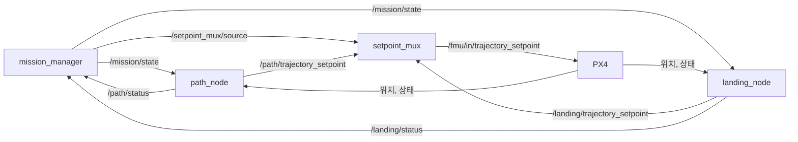

# 4. 탑재 소프트웨어 (ROS 2)

Companion computer에서 도는 미션 노드입니다. 패키지는 `ros2/ws/src/vtol_mission` 하나입니다.

## 1. 구성



| 노드 | 파일 | 하는 일 |
|---|---|---|
| `mission_manager` | `mission_manager.py` | 임무를 단계 목록으로 진행합니다. `WAIT_START → PATH → LANDING → MISSION_DONE`. 어디서든 `FAILSAFE`. |
| `setpoint_mux` | `setpoint_mux.py` | 지금 단계의 setpoint만 PX4로 보냅니다. PX4에 setpoint를 publish하는 유일한 노드입니다. 단계가 조용해지면 현재 위치를 유지합니다. |
| `path_node` | `path_node.py` | 단계 `PATH`: 상승, 호버, 가속, 순항, 감속, 호버. 천이 명령을 보내지 않습니다. |
| `landing_node` | `landing_node.py` | 단계 `LANDING`: 도착한 지점 위에서 하강하고, 4 m 아래에서 PX4 Land 모드에 넘깁니다. |

`path_node`와 `landing_node`가 보내는 setpoint는 `psi_vtol/profile.py`가 만듭니다. 시뮬레이션이
비행한 것과 같은 코드입니다. 고도, 속도, 가속 한계는
[`missions/2026_year_end/mission.yaml`](../missions/2026_year_end/mission.yaml)에서 읽습니다.

### 단계의 약속

단계 하나는 노드 하나이고, 모두 같은 약속을 따릅니다(`source.py`의 `SetpointSource`).

| 방향 | 토픽 | 내용 |
|---|---|---|
| 받음 | `/mission/state` | 이 값이 자기 단계 이름과 같을 때만 동작 |
| 보냄 | `/<단계>/trajectory_setpoint` | setpoint. `setpoint_mux`가 PX4로 전달 |
| 보냄 | `/<단계>/status` | `ACTIVE:<상태>`, `DONE`, `FAILED:<이유>` |

새 단계를 넣으려면 `SetpointSource`를 상속한 노드를 만들고 `launch/mission.launch.py`의 `STEPS`에
이름을 추가합니다. `mission_manager`와 `setpoint_mux`는 고치지 않습니다. Vision 정밀 착륙은 이
방식으로 `LANDING` 자리에 들어갑니다([5. 해야 할 일과 향후 과제](05_roadmap.md)).

### 중단

- `FAILED`를 받거나 `/mission/abort`에 `ABORT`가 오면 `FAILSAFE`로 가서 현재 위치를 유지합니다.
- 조종사가 offboard에서 나가거나 PX4 failsafe가 모드를 바꾸면, 노드는
  `FAILED:left offboard`를 보고하고 멈춥니다. 그 뒤는 조종사와 PX4가 맡습니다.
- 단계가 예상 시간을 넘기면 `FAILED:timeout`입니다.

## 2. PX4 연결

PX4 v1.17.0과 px4_msgs v1.17.0에 맞춰져 있습니다. 토픽 이름은 `vtol_mission/px4.py` 한 곳에
있고([`px4/README.md`](../px4/README.md)), ROS 파라미터 `px4_topic.<이름>`으로 바꿀 수 있습니다.

## 3. 빌드

px4_msgs는 이 repo에 넣지 않고 태그를 고정해 받습니다.

```bash
git clone --depth 1 -b v1.17.0 https://github.com/PX4/px4_msgs.git ros2/ws/src/px4_msgs
```

```bash
cd ros2/ws && colcon build && source install/setup.bash
```

노드는 `psi_vtol`을 repo에서 바로 읽습니다. repo 최상위를 `PYTHONPATH`에 넣습니다.

```bash
export PYTHONPATH=$PWD:$PYTHONPATH
```

## 4. 실행

```bash
ros2 launch vtol_mission mission.launch.py
```

```bash
ros2 topic pub --once /mission/start std_msgs/msg/String "{data: START}"
```

- 기본값에서는 노드가 arm하지 않습니다. `START` 뒤 조종사가 arm하고 offboard로 바꾸면 상승을
  시작합니다.
- 시뮬레이션에서는 `auto_arm:=true`를 붙여 노드가 offboard 전환과 arm을 요청하게 합니다.
- 진행은 `ros2 topic echo /mission/status`, `/path/status`, `/landing/status`,
  `/setpoint_mux/status`로 봅니다.

## 5. Jetson

`deploy/jetson/`에 Docker 구성이 있습니다. Pixhawk와 시리얼로 연결된 uXRCE-DDS agent와 ROS 2
Humble 컨테이너 두 개입니다. repo 전체가 컨테이너의 `/workspace`에 마운트됩니다.

```bash
docker compose -f deploy/jetson/compose.yaml up -d --build
```

```bash
docker exec -it ros2 bash
```

컨테이너 안에서 3절의 px4_msgs clone과 `colcon build`를 한 번 하고 4절대로 실행합니다. 시리얼
장치와 속도는 `compose.yaml`의 `PX4_UXRCE_DEV`, `PX4_UXRCE_BAUD`입니다.

이 Docker 구성은 PSI-vtol-team의 Jetson 구성에서 카메라·vision 패키지를 뺀 것이고, 새 구성으로는
아직 Jetson에서 빌드해 보지 않았습니다.
