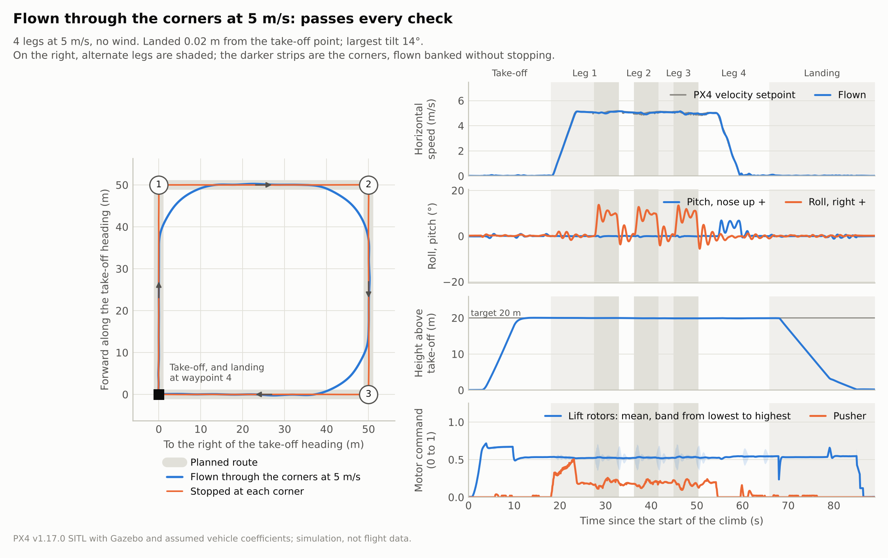
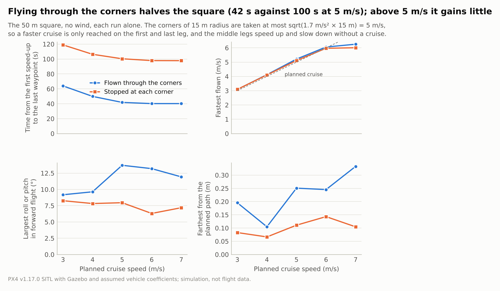
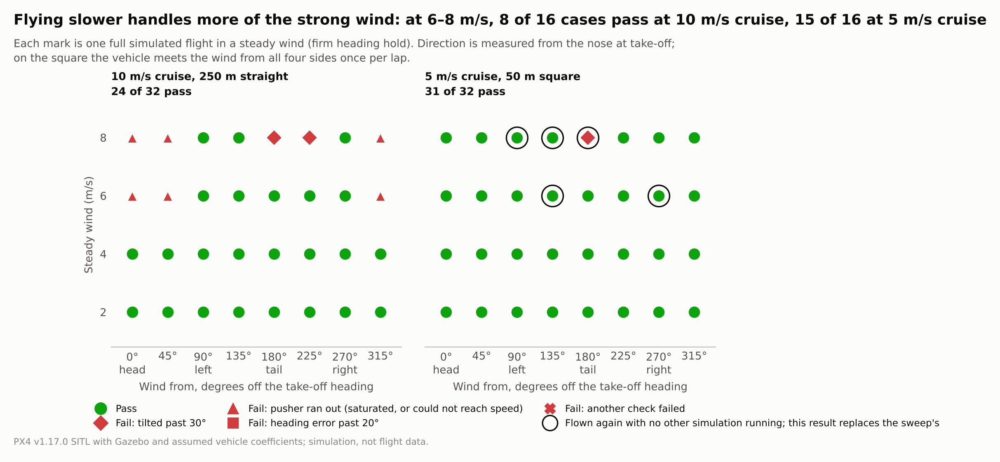
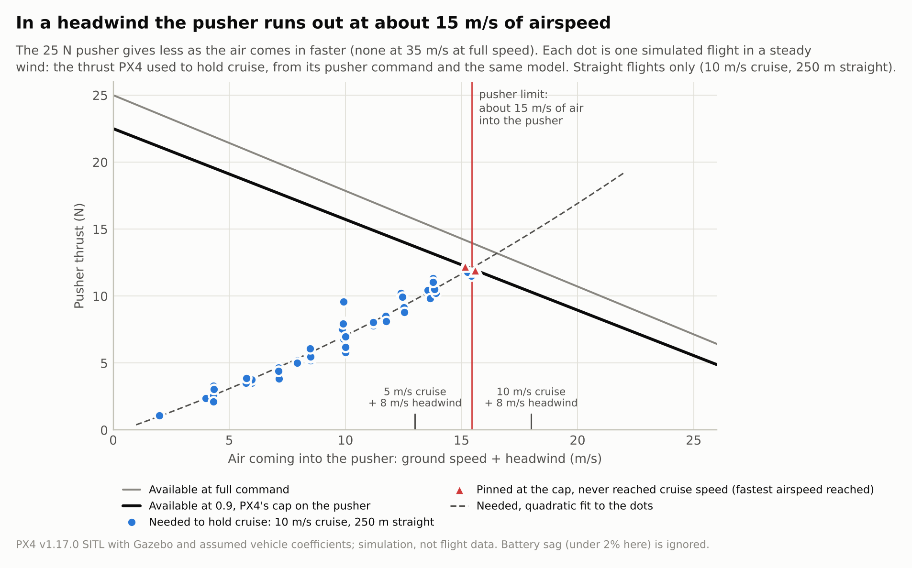
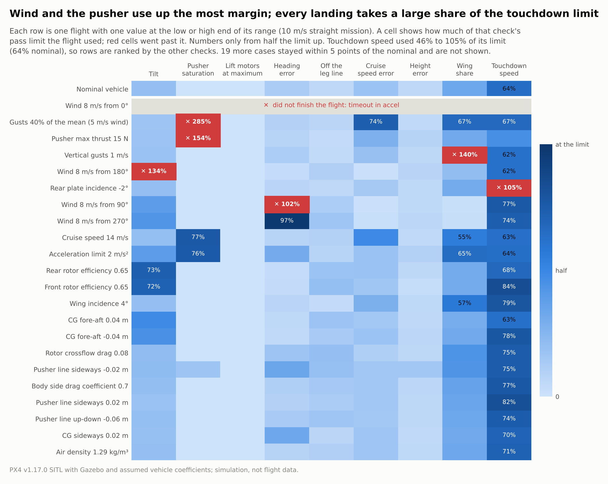
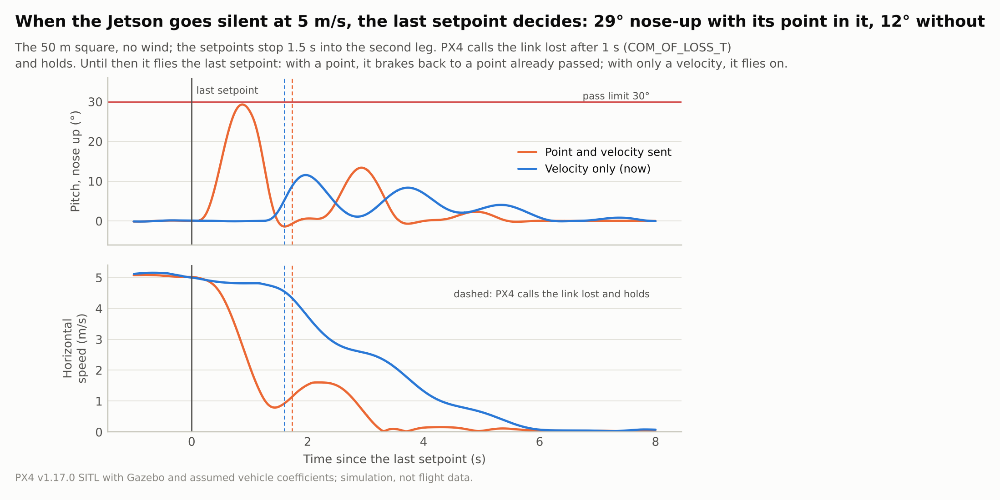

# 연말 비행 2026: 시뮬레이션으로 정할 것 (2026-10-18)

PX4 v1.17.0 SITL과 Gazebo, 이 저장소의 공력 플러그인(`aeroprop-v2`)으로 기본 임무(50 m 정사각형, 고도 20 m)를
비행한 결과에서, 연말 비행 전에 정해야 할 것만 추렸습니다. 기체 계수의 대부분이 가정값이므로 수치는 조건끼리
비교하는 데 쓰고, 실기체의 비행 허가 근거로 쓰지 않습니다. 2절과 4절은 다른 시뮬레이션 없이 혼자 돌렸고, 3절의
스윕은 두 개씩 함께 돌렸습니다([5절](#5-시뮬레이션을-어디까지-믿을-수-있나)). 케이스별 수치는
[evaluation/](evaluation/)에 있습니다.

## 1. 결정과 권고

| 정할 것 | 권고 | 근거 | 한계 |
|---|---|---|---|
| 경로를 나는 방식 | **통과 비행**(기본). 120°보다 급한 모서리만 멈춰서 돎 | 5 m/s 정사각형 42초(멈춰서 돌기 100초). 3–7 m/s 모두 통과([2절](#2-경로와-속도)) | 모서리 roll이 계획(9.7°)보다 큰 14°. 실기체에서 확인 |
| 순항 속도 | **5 m/s** | 50 m 정사각형에서는 5 m/s를 넘겨도 빨라지지 않음. 10 m/s는 8 m/s 정풍에서 푸셔가 모자람([3절](#3-바람)) | 푸셔 추력 곡선이 가정값 |
| 바람 한계 | **평균 6 m/s(돌풍 30%)까지.** 8 m/s면 바람을 마주 보고 이륙하고, 배풍 이륙은 하지 않음 | 6 m/s는 네 방향 모두 통과(최대 tilt 22°). 8 m/s 배풍 이륙은 pitch 35–45°로 실패, 8 m/s 측풍은 yaw 오차가 기준 20° 근처 | 동체 옆면 하중 모델이 단순해서 측풍 결과를 가장 덜 믿음. 문헌도 quadplane은 측풍에 약하다고 봄 [12] |
| 고장 대응 | **지금 구현대로.** 앞으로 갈 수 없는 고장(푸셔, 크게 뒤처짐)은 멈춘 뒤 Land, 그 밖의 중단은 멈춘 뒤 Hold. `COM_OF_LOSS_T` 1초, `VT_TRANS_TIMEOUT` 0.5초 | 고장 14가지 모두 넘어지지 않고 착지([4절](#4-고장)) | GPS 상실, 리프트 모터 고장, 센서 고장은 시험하지 못함 |
| 비행 전에 잴 것 | **CG**(모터 중심 ±2 cm 안으로), **푸셔 추력 곡선**, **장착 상태의 로터 효율**, yaw 권한 | 이 값들이 판정 여유를 가장 많이 바꿈(OAT, [3절](#3-바람)) | |
| 운용 절차 | 이륙은 바람을 마주 보고. 천이 스위치를 RC에 매핑하지 않음. 푸셔가 죽은 기체는 Position 모드로 데려올 수 없으므로 Land나 Stabilized | [4절](#4-고장), [2. 비행 방법](../../docs/02_flight.md#7-푸셔-보조) | |

## 2. 경로와 속도



경로는 이륙 전에 계획합니다. 모서리는 곡률이 0에서 서서히 늘었다 줄어드는 곡선(clothoid–원호–clothoid)이고
[7], 속도는 가속도를 0.7초에 걸쳐 키우고 줄여 바꿉니다[8]. 기체는 이 기준점의 속도와 가속도를 따라갑니다
[9, 10]. 자세한 방법은 [2. 비행 방법](../../docs/02_flight.md#2-경로-계획)에 있습니다.



| 순항 | 방식 | 경로 시간 | 최고 속력 | 최대 tilt | 경로 이탈 | 착지 오차 / 속력 |
|---:|---|---:|---:|---:|---:|---:|
| 3 m/s | 통과 | 64 s | 3.1 m/s | 9.2° | 0.20 m | 0.04 m / 0.67 m/s |
| 5 m/s | 통과 | 42 s | 5.2 m/s | 13.7° | 0.25 m | 0.02 m / 0.41 m/s |
| 7 m/s | 통과 | 40 s | 6.3 m/s | 11.9° | 0.33 m | 0.07 m / 0.44 m/s |
| 3 m/s | 멈춰서 돌기 | 119 s | 3.1 m/s | 8.3° | 0.08 m | 0.03 m / 0.34 m/s |
| 5 m/s | 멈춰서 돌기 | 100 s | 5.1 m/s | 8.0° | 0.11 m | 0.04 m / 0.51 m/s |
| 7 m/s | 멈춰서 돌기 | 98 s | 6.0 m/s | 7.2° | 0.10 m | 0.06 m / 0.39 m/s |

4 m/s와 6 m/s도 모두 통과했습니다. 모서리는 옆 가속도 1.7 m/s² 안에서 돌므로 반경 15 m에서
5 m/s가 상한이고, 50 m 변에서는 모서리를 나오자마자 다음 모서리를 위해 감속합니다. 그래서 7 m/s로 계획해도
최고 6.3 m/s이고 경로 시간은 5 m/s와 2초 차이입니다. 더 빨리 날 이유가 없으므로 5 m/s를 권합니다.

## 3. 바람



- **5 m/s 정사각형은 바람 32가지 중 31가지를 통과했습니다**(2–8 m/s × 8방향, 멈춰서 돌기). 돌풍 30%를 섞은
  6 m/s 바람은 통과 비행으로 네 방향 모두 통과했고, 가장 크게 기운 것은 오른쪽 바람의 22°입니다.
- **실패는 8 m/s 배풍 이륙입니다.** 상승 끝에서 기수가 35–45° 들렸습니다. 뒤에서 오는 바람을 버티려고 뒤로
  기울면 날개와 평판이 바람을 더 받아 더 기울어야 합니다. 바람을 마주 보고 이륙하면 피할 수 있습니다.
  착륙 직전에는 이미 기수를 바람 쪽으로 돌립니다(PX4의 weathervane과 같은 원리 [4], 문헌의 결과도 같은
  방향 [13]).
- **8 m/s 측풍에서는 yaw 오차가 18–22°로 기준(20°) 근처입니다.** 리프트 로터의 반토크로 내는 yaw 권한이
  한계이고, 게인을 올려도 나아지지 않았습니다. 이 결과는 동체 옆면 하중을 단순하게 넣은 모델에서 나왔으므로
  실측으로 확인해야 합니다. 같은 구성의 quadplane 연구도 정풍보다 측풍에 약하고, CG 위치와 로터 기울기가
  바람 저항을 크게 바꾼다고 보고합니다[12].

**순항 속도를 높이면 정풍에서 푸셔가 먼저 모자랍니다.** 10 m/s 직선에서 6–8 m/s 정풍을 받으면 푸셔가
포화되고, 8 m/s에서는 목표 속도에 닿지 못했습니다. 푸셔로 들어오는 바람이 약 15 m/s를 넘으면 PX4가 허용하는
최대 명령(0.9)으로도 순항에 필요한 추력을 내지 못합니다. 5 m/s 순항이면 8 m/s 정풍에서도 13 m/s입니다.



**무엇을 먼저 재야 하나.** 불확실한 값을 하나씩 범위 끝으로 바꿔 본 61가지(OAT, 10 m/s 직선) 중 7가지가
실패했고, 판정 여유를 크게 쓴 값은 다음과 같습니다.



| 값 | 영향 |
|---|---|
| 푸셔 최대 추력 15 N(기준 25 N) | 푸셔 포화로 실패 |
| 앞 또는 뒤 로터의 장착 효율 0.65 | pitch 적분기를 한계의 93%까지 쓰고 tilt 22° |
| CG 전후 ±4 cm | 적분기 43%, tilt 13–14° |
| 수직 돌풍 1 m/s | 날개 부담 순간값 56%(기준 40%) |

게인을 바꿔서 해결되는 실패는 없었습니다. 남은 문제는 추력 여유(푸셔, yaw 반토크)와 운용 조건입니다.

## 4. 고장

비행 중에 고장을 일부러 일으켜(`run_case --event`) 14가지를 비행했습니다. 모두 넘어지지 않고 tilt 30° 안에서
착지했습니다.

| 고장 | 대응 | 최대 tilt | 착지 속력 |
|---|---|---:|---:|
| 임무 중단 (순항, 모서리, 7 m/s) | 9.7–13 m에 걸쳐 멈춤(tilt 10–11°) → Hold → Land | 11–14° | 0.42–0.71 m/s |
| Jetson 정지 (순항, 7 m/s, 옆바람 6 m/s 속 모서리) | PX4가 1초 뒤 Hold [1] | 12–17° | 0.50–0.58 m/s |
| 푸셔 고장 (호버, 순항, 7 m/s, 정풍 6 m/s, 멈춰서 돌기) | 5–8초 안에 알아챔(멈춰서 돌기는 다음 가속에서) → 멈춤 → 그 자리에 Land | 8–19° | 0.36–0.68 m/s |
| 배터리 위험 수준 | PX4가 5초 Hold 뒤 Return [2], 이륙 지점 0.04 m 옆 착지 | 14° | 0.41 m/s |
| 천이 명령 (호버, 순항) | PX4가 0.5초 뒤 취소하고 쿼드로 계속 [3] | 13–14° | 0.55–0.66 m/s |

PX4의 모터 고장 주입은 ESC 텔레메트리만 지우므로[5] 푸셔는 공력 플러그인에서 껐습니다. 이 결과를 얻기까지
고친 세 가지가 고장 대응의 근거입니다.



- **Jetson이 멈추면 PX4는 마지막 setpoint를 1초 동안 계속 따릅니다[1].** 거기에 기준점의 위치가 있으면
  이미 지나친 점으로 되돌아가려고 기수가 29° 들렸습니다. 지금은 움직이는 동안 위치 대신 속도를 보내므로
  12°로 멈춥니다.
- **푸셔가 죽은 기체를 Hold에 두면 위험합니다.** 푸셔 보조가 기수를 숙이지 못하게 하므로 PX4가 죽은 푸셔를
  최대로 돌리며 버티고, 그 뒤 Land로 바꾸자 기수가 ±45° 흔들렸습니다. 그래서 앞으로 갈 수 없는 고장은 곧바로
  Land로 넘깁니다. Land에서는 푸셔 보조가 꺼져 기체가 기울여 제자리를 지킵니다.
- **천이를 시도하는 동안 PX4는 offboard setpoint를 따르지 않습니다.** 취소까지 3초면 모서리를 놓쳐 roll
  25°까지 기울었고, 0.5초로 줄여 13°가 됐습니다. 취소된 뒤에는 재부팅 전까지 다시 arm할 수 없습니다.

## 5. 시뮬레이션을 어디까지 믿을 수 있나

- **기체 계수.** 질량과 리프트 모터 추력 외에는 대부분 가정값입니다. 비교와 경향은 믿을 만하지만 한계값(예:
  측풍 몇 m/s까지)은 실측 뒤에 다시 돌려야 합니다. 모델에 없는 것은
  [4. 시뮬레이션](../../docs/04_simulation.md#4-모델에-없는-것)에 있습니다.
- **측풍.** 동체와 붐의 하중이 축별 항력뿐이라 측풍의 yaw 모멘트가 작게 나옵니다. 측풍 결과는 낙관적일 수
  있습니다.
- **동시 실행.** PX4의 시계는 Gazebo를 따르지만[6], Gazebo는 PX4의 모터 명령을 기다리지 않습니다. 시뮬레이션을
  여러 개 함께 돌리면 실제 기체에 없는 제어 지연이 생겨 1 Hz 흔들림이 나타났습니다. 2절과 4절은 혼자
  돌렸습니다. 3절의 스윕은 두 개씩 함께 돌렸고, 5 m/s 정사각형 바람 스윕만 의심스러운 케이스를 혼자 다시
  돌렸습니다. 10 m/s 직선에서 기준을 조금 넘은 한 건짜리 실패(측풍 yaw 20.4°, 수직 돌풍의 날개 부담 56%)는
  혼자 다시 돌려 확인해야 합니다.
- **추종 오차.** 실기체에서는 PX4 게인, 센서 잡음, 바람 변화가 더해집니다. 모서리 roll(계획 9.7°, SITL 14°)과
  착지 속력(0.3–0.7 m/s)은 첫 비행 시험에서 먼저 확인할 값입니다.

## 6. 참고 문헌

1. PX4, [Offboard Mode](https://docs.px4.io/v1.17/en/flight_modes/offboard) — setpoint 스트림이 끊겼을 때의
   동작(`COM_OF_LOSS_T`, `COM_OBL_RC_ACT`).
2. PX4, [Safety (Failsafe) Configuration](https://docs.px4.io/main/en/config/safety) — 배터리, 지오펜스
   failsafe(`COM_LOW_BAT_ACT`, `GF_ACTION`).
3. PX4, [Standard VTOL Configuration](https://docs.px4.io/main/en/config_vtol/vtol_quad_configuration) — 천이와
   quad-chute.
4. PX4, [VTOL Weather Vane](https://docs.px4.io/v1.17/en/config_vtol/vtol_weathervane) — 기울기로 바람 방향을
   추정해 기수를 바람 쪽으로 돌림.
5. PX4, [Failure Injection](https://docs.px4.io/main/en/debug/failure_injection) — 시뮬레이터별로 주입할 수 있는
   고장이 다름.
6. PX4, [Gazebo Simulation](https://docs.px4.io/v1.17/en/sim_gazebo_gz/) — `PX4_SIM_SPEED_FACTOR`, PX4 시계와
   Gazebo의 관계.
7. T. Fraichard, A. Scheuer, "From Reeds and Shepp's to continuous-curvature paths," *IEEE Transactions on
   Robotics* 20(6), 1025–1035, 2004. [HAL](https://hal-univ-tlse3.archives-ouvertes.fr/INRIA/inria-00000009) —
   곡률이 연속인 경로(clothoid 전이).
8. L. Berscheid, T. Kröger, "Jerk-limited Real-time Trajectory Generation with Arbitrary Target States,"
   *Robotics: Science and Systems*, 2021. [doi:10.15607/RSS.2021.XVII.015](https://doi.org/10.15607/RSS.2021.XVII.015)
   — 가속도 변화율을 제한한 속도 계획.
9. D. Mellinger, V. Kumar, "Minimum snap trajectory generation and control for quadrotors," *IEEE ICRA*, 2011.
   [doi:10.1109/ICRA.2011.5980409](https://doi.org/10.1109/ICRA.2011.5980409) — 기준 궤적의 미분으로 자세와
   추력 feedforward를 구함.
10. M. Faessler, A. Franchi, D. Scaramuzza, "Differential Flatness of Quadrotor Dynamics Subject to Rotor Drag
    for Accurate Tracking of High-Speed Trajectories," *IEEE Robotics and Automation Letters* 3(2), 620–626, 2018.
    [doi:10.1109/LRA.2017.2776353](https://doi.org/10.1109/LRA.2017.2776353) — 가속도 feedforward가 추종 오차를
    줄임.
11. G. Ducard, M. Allenspach, "Review of designs and flight control techniques of hybrid and convertible VTOL
    UAVs," *Aerospace Science and Technology* 118, 107035, 2021. [HAL](https://hal.archives-ouvertes.fr/hal-03507633)
12. Li 외, "Dynamic Simulation and Conceptual Layout Study on a Quad-Plane in VTOL Mode in Wind Disturbance
    Environment," *International Journal of Aerospace Engineering* 2022, 5867825.
    [doi:10.1155/2022/5867825](https://doi.org/10.1155/2022/5867825) — 날개 때문에 바람에 약하고, CG와 로터
    기울기가 바람 저항을 바꿈.
13. S. Wang, X. Chen, H. Wei, Q. Quan, "Heading Adjustment by Admittance Control for Lifting-Wing Quadcopters in
    Strong Winds," *IEEE Robotics and Automation Letters* 10(4), 3558–3565, 2025 — 기수를 바람에 맞추면 호버
    정확도와 바람 저항이 좋아짐.

hybrid VTOL의 설계와 제어 방식은 [11]이 정리했고, 조종면 없는 pusher quadplane에 대한 선행 연구는
[7. 할 일](../../docs/07_roadmap.md#4-custom-px4)에, 이 결과에서 얻은 교훈은 [6. 교훈](../../docs/06_lessons.md)에
있습니다.

## 7. 다시 돌리기

환경은 [simulation/README.md](../../simulation/README.md)를 따릅니다. 스윕은 한 번에 하나씩 돕니다.

```bash
bash simulation/docker_run.sh python3 -m psi_vtol.sim.sweep scenarios      # 2절, 4절
bash simulation/docker_run.sh python3 -m psi_vtol.sim.sweep wind           # 3절
bash simulation/docker_run.sh python3 -m psi_vtol.sim.sweep oat            # 3절
bash simulation/docker_run.sh python3 -m psi_vtol.sim.run_case --event pusher_off@cruise2+1
```

그림은 결과 JSON에서 다시 그립니다(`python3 -m psi_vtol.plots --help`). 센서 잡음과 돌풍의 seed를 고정하지
않아서 같은 케이스도 소수점 아래는 조금씩 다릅니다.
