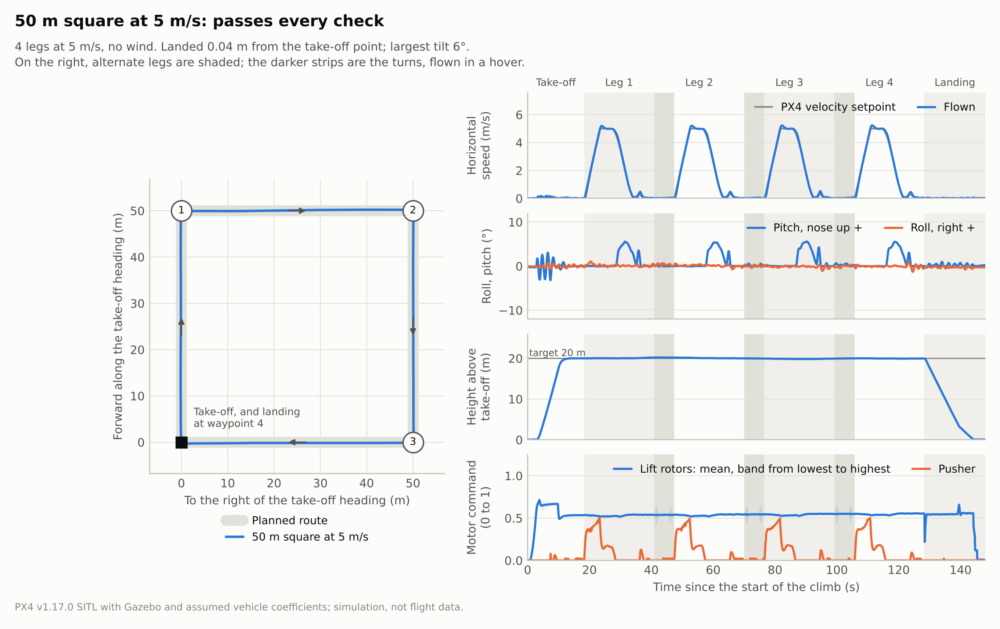
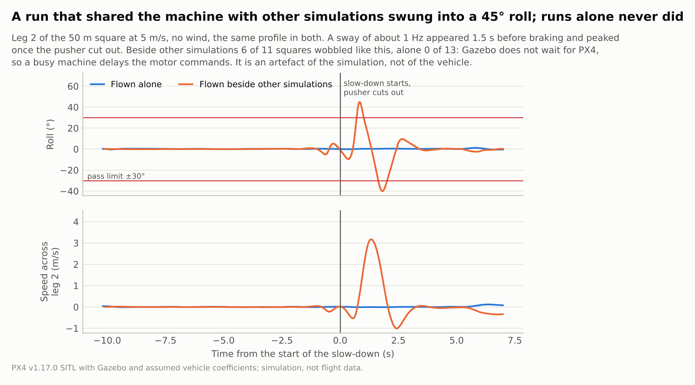
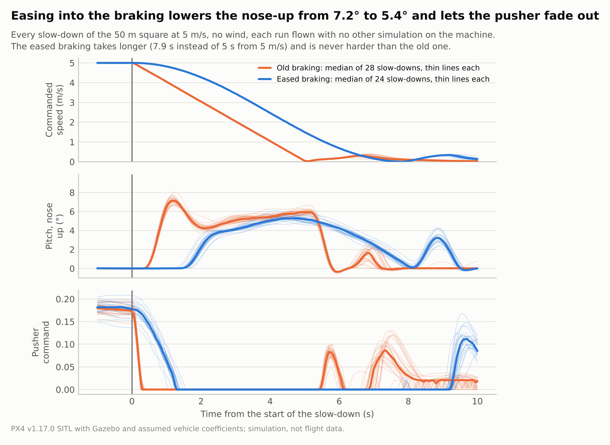

# 연말 비행 2026: 시뮬레이션 결과 (2026-10-18)

이번 실행에서 한 일은 다섯 가지입니다.

1. 기존 10 m/s 직선 임무로 corner, OAT, 바람 스윕을 처음으로 모두 돌렸습니다.
2. 새 경로 임무(갔다가 돌아오기, 50 m 정사각형)를 PX4 SITL로 비행하고, 5 m/s 정사각형으로 바람 스윕을
   다시 돌렸습니다.
3. 실패 원인을 묶어 보고, 파라미터나 운용으로 고칠 수 있는 것을 시험했습니다.
4. 감속을 부드럽게 바꾸고(속도보다 자세 우선) 다시 비행했습니다.
5. 정사각형에서 가끔 생기던 1 Hz 흔들림이 시뮬레이션을 여러 개 동시에 돌린 탓임을 확인했습니다.

모든 수치는 가정한 계수로 만든 모델의 결과입니다. 실제 비행이나 측정으로 확인한 값이 아닙니다. 이전
실행은 [2026-10-13 보고서](archive/2026-10-13_report.md)에 있습니다.

## 요약

- **스윕(10 m/s 직선):** corner 0/7, OAT 54/61, 바람 49/64. 2 m/s와 4 m/s 바람은 모두 통과했습니다.
- **실패는 세 갈래입니다.** 정풍 6 m/s 이상에서 푸셔가 모자라고, 8 m/s 배풍을 받으며 상승·호버하면 기수가
  37–45° 들리고, 나머지는 판정 기준을 조금 넘는 경계 사례입니다.
- **속도를 낮추면 바람에 강해집니다.** 5 m/s 정사각형은 firm 기수 유지로 바람 32건 중 30건을 통과했습니다
  (10 m/s 직선은 24건). 6–8 m/s만 보면 16건 중 14건과 8건입니다. 정풍에서 푸셔가 모자라던 실패가
  사라졌고, 남은 두 건 중 배풍 이륙은 혼자 돌려도 재현되는 진짜 실패입니다.
- **감속을 부드럽게 했습니다.** 감속을 한 번에 1 m/s²로 시작하지 않고 0에서 키웠다가 다시 줄입니다.
  제동 때 기수 들림이 7.2°에서 5.4°로 줄고, 푸셔가 0.2초 대신 약 0.9초에 걸쳐 꺼집니다. 제동 거리는 5 m/s에서 12.5 m → 19.6 m입니다.
- **1 Hz 흔들림은 시뮬레이션 환경 탓이었습니다.** 다른 시뮬레이션과 함께 돌린 정사각형 11회 중 6회에서
  생겼고, 혼자 돌린 13회에서는 한 번도 없었습니다. PX4의 Gazebo bridge에는 lockstep이 없어서 컴퓨터가
  바쁘면 모터 명령이 늦게 도착합니다. 스윕은 이제 기본으로 한 번에 하나씩 돌립니다.
- **바로 할 수 있는 것:** 바람을 마주 보고 이륙하기, 순항 속도를 5 m/s 근처로 유지하기, 착륙 속도 판정
  여유 늘리기. 펌웨어를 고치지 않아도 됩니다. `VT_PITCH_MIN`으로 푸셔를 돕는 방법은 PX4 구조상 효과가
  없었습니다. 자세한 내용은 [7절](#7-조정할-수-있는-것)에 있습니다.

## 1. 실행 환경

| 항목 | 값 |
|---|---|
| 호스트 | Linux 컨테이너, x86-64, 4 CPU, RAM 15 GB. Docker를 쓸 수 없어 이미지 대신 직접 구성 |
| PX4 | v1.17.0 `d6f12ad`, 소스 수정 없음 |
| Gazebo | Sim 8.10.0 (conda-forge). 10-13 실행은 8.15.0 |
| 10 m/s 직선 스윕 코드 | commit `ea4a289` (`main`의 `d7178e1`과 같은 코드), 직선 250 m 임무 |
| 경로 임무 코드 | 갔다가 돌아오기는 commit `44f13d6`, 정사각형과 정사각형 바람 스윕은 `955e658` |

Docker 이미지를 쓰지 않아서 빌드에 두 가지를 다르게 했습니다. conda-forge의 protobuf가 C++17을 요구하므로
PX4의 Gazebo bridge 소스만 C++17로 컴파일했고, 공력 플러그인은 실제로 쓰는 라이브러리만 링크했습니다
(`-Wl,--as-needed`). PX4 소스와 이 저장소의 코드는 그대로입니다.

이 환경에서 처음 돌렸을 때 모든 케이스가 "PX4 did not answer for parameter"로 실패했습니다. PX4가 막 켜지는
동안 받은 파라미터 요청을 버리는데, runner가 한 번만 묻고 포기했기 때문입니다. 1초마다 다시 묻도록
고쳤습니다(`d7178e1`).

[케이스별 수치와 실행 환경](evaluation/2026-10-18_sitl_results.json)을 저장소에 남겼습니다. ULog와 실행
폴더는 실행한 컴퓨터의 `out/`에 있습니다.

## 2. 환경이 바뀌어도 nominal은 같은가

10 m/s 직선 nominal을 두 환경에서 비교했습니다.

| 지표 | 10-13 (Docker, Gazebo 8.15) | 10-18 (직접 구성, Gazebo 8.10) |
|---|---:|---:|
| 최대 tilt | 5.91° | 5.75° |
| 고도 오차 | 0.16 m | 0.16 m |
| yaw 오차 | 2.50° | 2.11° |
| 순항 평균 속도 | 9.856 m/s | 9.847 m/s |
| 푸셔 최대 명령 | 0.766 | 0.769 |
| 리프트 명령 범위 | 0.455–0.561 | 0.454–0.562 |
| 최대 날개 부담 | 12.5% | 13.1% |
| 착륙 속력 | 0.029 m/s | 0.665 m/s |

착륙 속력만 크게 다른데, 이건 판정 방식을 고쳤기 때문입니다. 예전에는 land detector가 착륙을 알린
순간(이미 멈춘 뒤)의 속력을 썼고, 지금은 접지 직전 3초의 최대 속력을 씁니다. 0.665 m/s는 PX4 Land의 하강
속도 0.7 m/s와 맞습니다. 나머지는 거의 같으므로, 환경 차이가 결과를 바꾸지 않았다고 봅니다.

## 3. 스윕: 10 m/s 직선 250 m

범위는 그때의 `study.yaml`입니다(순항 속도 6–14 m/s). 지금 `study.yaml`은 정사각형 임무에 맞춰 3–7 m/s로
바꿨습니다.

이 스윕은 두 개씩 동시에 돌렸습니다. 5절에서 보듯 그러면 가끔 실제 기체에는 없는 흔들림이 생깁니다. 방향이나
값에 따라 일관되게 나온 실패(정풍의 푸셔 부족, 배풍 이륙)는 믿을 만하지만, 기준을 조금 넘은 한 건짜리
실패(측풍 yaw 20.4°, 착륙 속력 1.05 m/s, 수직 돌풍의 날개 부담 56%)와 corner의 측풍 + 돌풍은 혼자 다시
돌려 확인해야 합니다. 이번에는 다시 돌리지 않았습니다.

### Corner 0/7

10-13 실행과 같은 양상입니다. 약한 푸셔 + 정풍은 가속 단계 시간 초과(푸셔 포화 95%), 높은 양력 + 급제동은
날개 부담 51%와 푸셔 포화 12%, 무거움 + 저전압 + 로터 손실은 상승 실패, 측풍 + 돌풍은 yaw를 잃고(기수
오차 144–163°) 리프트 모터 포화, 배풍 + 저속 순항은 tilt 38.7°였습니다.

### OAT 54/61


**그림 읽는 법.** 한 줄이 비행 한 번입니다. 칸의 색은 그 판정 기준의 몇 %를 썼는지이고, 진할수록 기준에
가깝습니다. 빨간 칸은 기준을 넘은 것, 회색 줄은 비행을 끝내지 못한 것입니다. 맨 위 nominal 줄과 비교해서
읽으면 됩니다. 착륙 속력은 모든 케이스가 기준의 46–105%를 써서 줄 순서는 나머지 기준으로 정했습니다.
nominal과 5%p 넘게 다르지 않은 19건은 뺐습니다.

| 실패한 케이스 | 이유 |
|---|---|
| 푸셔 최대 추력 15 N | 푸셔 포화 15% (기준 10%) |
| 돌풍 40% (평균풍 5 m/s) | 푸셔 포화 28% |
| 정풍 8 m/s | 가속 단계 시간 초과, 푸셔 포화 76% |
| 배풍 8 m/s | 상승 중 pitch 40° |
| 측풍 8 m/s (왼쪽) | yaw 오차 20.4° (기준 20°) |
| 수직 돌풍 1 m/s | 날개 부담 순간 최댓값 56% (기준 40%) |
| 평판 붙임각 −2° | 착륙 속력 1.05 m/s (기준 1.0) |

통과했지만 여유가 적은 경우도 있습니다. 앞 또는 뒤 로터 장착 효율 0.65는 pitch 적분기를 한계 0.30 중
0.28까지 쓰고 tilt 22°, CG 전후 ±4 cm는 적분기 0.13과 tilt 13–14°, 가속 한계 2 m/s²는 tilt 12°였습니다.

### 바람 49/64

그림은 [4절의 정사각형 결과](#정사각형-바람-스윕-5-ms)와 함께 있습니다.

- **2, 4 m/s는 모두 통과**했습니다.
- **정풍 쪽(0°, ±45°) 6–8 m/s: 11건 실패.** 모두 푸셔 포화이고, 8 m/s 정면·앞 오른쪽에서는 목표 속도에
  닿지 못해 가속 단계가 시간 초과됐습니다. 아래 그림처럼 푸셔로 들어오는 바람이 약 15 m/s를 넘으면 25 N
  푸셔가 PX4 상한(명령 0.9)에서 낼 수 있는 추력이 순항에 필요한 추력보다 작아집니다.


**그림 읽는 법.** 검은 선은 푸셔가 낼 수 있는 최대 추력입니다. 들어오는 바람이 빠를수록 줄어듭니다. 파란
점은 직선 비행 한 번마다 PX4가 순항을 유지하려고 실제로 쓴 추력입니다(푸셔 명령과 같은 모델로 계산).
점선(필요 추력)이 검은 선을 넘는 곳부터는 순항 속도를 유지할 수 없고, 빨간 삼각형은 실제로 상한에 붙어
목표 속도에 못 간 비행입니다. x축은 대지 속도 + 정풍 성분이므로, 5 m/s 순항에 8 m/s 정풍은 13 m/s, 10 m/s
순항이면 18 m/s입니다.
- **배풍 8 m/s(180°, 225°): 3건 실패.** 상승 끝이나 첫 호버에서 기수가 37–45° 들렸습니다. 뒤에서 오는 바람을
  버티려고 기체를 뒤로 기울이면 날개와 평판이 바람을 더 받아 더 기울여야 하는 구조입니다.
- **측풍 8 m/s(90°)**는 firm 정책에서 yaw 오차 18°로 간신히 통과했습니다.
- firm과 soft 기수 유지는 실패 수가 8건과 7건으로 비슷했습니다. 차이는 225° 배풍 한 건입니다.

## 4. 경로 임무

### 갔다가 돌아오기 (10 m/s, 250 m)

통과했습니다. 이륙 지점에서 0.08 m 떨어져 착륙했고, 최대 tilt 7.1°, 구간 직선 이탈 0.4 m, 순항 속도 오차
0.17 m/s, yaw 오차 3.0°였습니다. 첫 시도에서는 경유점 위 호버가 시작될 때 기수가 20° 들렸습니다. 기체가
경유점을 1 m쯤 지나쳐 멈추는데 호버 목표를 경유점으로 한 번에 옮겼기 때문입니다. 멈춘 자리에서
0.5 m/s로 옮겨 가게 바꾼 뒤 7.1°(평소 제동 자세)가 됐습니다.

### 50 m 정사각형, 오른쪽 회전 (5 m/s)

아래 표는 다른 시뮬레이션 없이 혼자 돌린 무풍 실행만 모은 것입니다. 다른 시뮬레이션과 함께 돌린 실행은
결과가 흔들려서 5절에 따로 정리했습니다. 기존 감속 7회 중 한 번은 CPU를 일부러 포화시킨 상태였습니다.

| 지표 | 기존 감속, 7회 | 부드러운 감속(6절), 6회 | 기준 |
|---|---:|---:|---:|
| 통과 | 7 | 6 | |
| 최대 tilt | 7.1–8.1° | 5.3–6.1° | 30° |
| 구간 직선 이탈 | 0.21–0.39 m | 0.17–0.43 m | 3 m |
| 순항 속도 오차 | 0.22–0.23 m/s | 0.22–0.23 m/s | 1 m/s |
| yaw 오차 | 1.6–3.5° | 1.7–2.4° | 20° |
| 고도 오차 | 0.14–0.18 m | 0.15–0.22 m | 3 m |
| 착륙 위치 오차 | 0.01–0.08 m | 0.03–0.05 m | 2 m |
| 착륙 속력 | 0.63–0.79 m/s | 0.64–0.69 m/s | 1 m/s |

최대 tilt는 두 경우 모두 감속할 때의 pitch입니다. 부드러운 감속에서 약 2° 낮아졌습니다.



**그림 읽는 법.** 부드러운 감속으로 혼자 돌린 실행입니다. 왼쪽은 위에서 본 궤적으로, 회색 굵은 선이 계획
경로, 파란 선이 실제 비행입니다. 오른쪽은 시간에 따른 수평 속력, 자세, 고도, 모터 명령입니다. 변마다
가속–순항–감속–호버가 반복되고, 진한 회색 띠가 호버 상태에서 기수를 돌리는 구간입니다. 푸셔(주황)는
가속과 순항에서만 일하고, 감속이 시작되면 서서히 꺼집니다. 리프트 모터 명령은 변 사이에서도 거의
그대로입니다.

### 정사각형 바람 스윕 (5 m/s)

10 m/s 직선과 같은 바람 스윕(2/4/6/8 m/s × 8방향 × 기수 유지 2가지)을 5 m/s 정사각형으로 돌렸습니다.
스윕은 두 개씩 동시에 돌렸고, 5절의 흔들림 때문에 실패 두 건과 tilt가 18° 넘게 나온 통과 세 건을 혼자 다시
비행했습니다.

| 케이스 (firm) | 스윕 (동시 실행) | 혼자 다시 |
|---|---|---|
| 8 m/s, 90° | 실패, tilt 35.5° (감속) | 통과, 11.9° |
| 6 m/s, 135° | 통과, 26.1° (상승) | 통과, 9.9° |
| 6 m/s, 270° | 통과, 18.7° (감속) | 통과, 10.7° |
| 8 m/s, 135° | 통과, 26.0° (상승) | 통과, 21.9° (상승) |
| 8 m/s, 180° | 실패, 41.7° (상승) | 실패, 34.8° (상승) |

혼자 다시 돌린 결과를 넣으면 **firm은 32건 중 31건 통과**입니다(10 m/s 직선은 24건). 6–8 m/s만 보면 16건 중
15건과 8건입니다. 남은 실패는 8 m/s 배풍 이륙 하나이고, 뒤쪽에서 비스듬히 오는 8 m/s 바람(135°)도 상승
끝에서 pitch가 22°까지 들렸습니다. **soft는 32건 모두 실패**했는데, 바람 때문이 아니라 회전 뒤 기수가 늦기
때문입니다(2 m/s에서도 가속 시작 때 기수가 29° 늦음, 7절 표).


**그림 읽는 법.** 점 하나가 정해진 바람 속에서 끝까지 비행한 한 번입니다(firm 기수 유지). 초록 원은 통과,
빨간 모양은 실패이고 모양이 실패 이유를 나타냅니다. 바람 방향은 이륙할 때의 기수를 기준으로 잽니다.
정사각형은 모서리마다 방향을 바꾸므로 바람이 어디서 오든 정풍·측풍·배풍 구간을 모두 지납니다. 그래서
정사각형에서 방향이 다르면 주로 이륙과 첫 호버에서 받는 바람이 달라집니다.

스윕과 따로, 8 m/s 바람에서 네 방향을 혼자 비행해 자세히 본 결과입니다(기존 감속).

| 바람 방향(이륙 기수 기준) | 결과 | 최대 tilt | 비고 |
|---|---|---:|---|
| 0° (이륙 때 정풍) | 통과 | 11.7° | 정풍 구간 가속에서 푸셔가 상한 0.9에 잠깐 닿음(비행의 3%) |
| 90° (이륙 때 왼쪽) | 실패 | 11.9° | 측풍 구간에서 yaw 오차 21.9° (기준 20°). 같은 케이스를 다시 돌리면 12.8°, 13.7°로 경계에 있음 |
| 180° (이륙 때 배풍) | 실패 | 39.3° | 상승 끝에서 pitch 39°. 10 m/s 직선의 배풍 실패와 같은 양상 |
| 270° (이륙 때 오른쪽) | 통과 | 12.0° | |

10 m/s 직선에서는 8 m/s 정풍을 받으면 목표 속도에 닿지 못했지만, 5 m/s 정사각형은 정풍 구간도 순항했습니다.
남은 문제는 이륙 때의 배풍과 경계에 있는 측풍 yaw로, 순항 속도와 관계없는 문제입니다.

## 5. 1 Hz 흔들림: 시뮬레이션을 동시에 돌린 탓

정사각형에서 가끔 약 1 Hz로 기체가 흔들렸습니다. 처음 본 것은 무풍 첫 실행의 두 번째 변으로, 감속 1.5초
전에 생긴 흔들림이 1초에 열 배쯤 커져 감속 시작 0.9초 뒤 roll 45°까지 갔습니다. 다른 실행에서는 감속, 호버
중 회전, PX4 Land 모드의 착륙에서 roll이나 pitch가 14–56° 흔들렸습니다. Land 모드에서는 이 저장소의 코드가
setpoint를 보내지 않으므로, 프로파일 문제로는 설명되지 않습니다.

실행 시각을 맞춰 보니 다른 시뮬레이션이 같은 컴퓨터에서 돌고 있었는지가 갈랐습니다.

| 정사각형 실행 | 회수 | 1 Hz 흔들림 또는 tilt 실패 |
|---|---:|---:|
| 혼자 (무풍, 기존 감속 7 + 부드러운 감속 6) | 13 | 0 |
| 다른 시뮬레이션 2–9개와 함께 (무풍 9, 8 m/s 바람 2) | 11 | 6 |

CPU를 busy loop로 일부러 포화시킨 실행은 멀쩡했으므로, 단순히 CPU가 바쁜 것만은 아닙니다. 원인으로 보는
것은 PX4와 Gazebo의 시간 관계입니다. PX4 v1.17의 Gazebo bridge(`src/modules/simulation/gz_bridge`)는 Gazebo의
시계를 따라갈 뿐 lockstep이 없어서, Gazebo는 PX4를 기다리지 않고 4배속으로 진행합니다. 시뮬레이션 여러 개가
CPU를 나눠 쓰다 PX4가 뒤처지면 모터 명령이 시뮬레이션 시간으로 늦게 도착하고, 실제 기체에는 없는 제어
지연이 생깁니다. 지연이 시뮬레이션 쪽에서만 생기므로 PX4 로그로는 직접 보이지 않습니다.



**그림 읽는 법.** 같은 프로파일(기존 감속)로 같은 변을 비행한 두 실행입니다. 파란 선은 혼자 돌린 실행,
주황 선은 다른 시뮬레이션과 함께 돌린 실행입니다. 0초가 감속 시작이고, 빨간 선이 tilt 판정 기준 ±30°입니다.

바꾼 것:

- 스윕의 기본 동시 실행 수를 3에서 1로 바꿨습니다(`--jobs`). 문서의 명령도 고쳤습니다.
- 실행 결과에 함께 돌던 PX4 수를 남깁니다(`flight.other_simulators`). 0이 아니면 경고를 출력합니다.

이번 스윕은 두 개씩 동시에 돌렸으므로, 한 번만 나온 흔들림성 실패는 다시 볼 필요가 있습니다. 방향에 따라
일관되게 나온 실패(정풍의 푸셔 부족, 배풍 이륙)는 모델 자체의 결과로 봅니다. 배풍 이륙은 혼자 돌려도
기존 감속 34.8°, 부드러운 감속 41.5°로 재현됐습니다. 의심스러운 정사각형 스윕 케이스를 혼자 다시 돌린
결과는 4절에 있습니다.

## 6. 부드러운 감속

속도를 정확히 지키는 것보다 자세가 중요하므로 감속을 바꿨습니다(`psi_vtol/profile.py`).

- **전:** 순항이 끝나는 순간 속도 명령을 1 m/s²로 줄이기 시작했습니다. 감속도가 0에서 1 m/s²로 계단처럼
  바뀌니 PX4의 pitch setpoint도 한 번에 바뀌고, pusher assist가 푸셔를 한 번에 끕니다.
- **후:** 속도 명령이 반쪽 코사인 모양으로 줄어듭니다. 감속도가 0에서 시작해 한가운데서만 1 m/s²가 되고 끝에서
  다시 0이 됩니다. 5 m/s에서 감속은 5초·12.5 m에서 7.9초·19.6 m가 되고, 50 m 변의 순항은 5초에서 3.6초로
  줄어듭니다. 순항 속도는 그대로입니다.

혼자 돌린 무풍 정사각형의 모든 감속(기존 7회 × 4변, 부드러운 감속 6회 × 4변)을 겹쳐 그렸습니다.



| 감속 한 번마다 | 기존 (28회) | 부드러운 감속 (24회) |
|---|---:|---:|
| 최대 pitch (기수 들림) | 6.6–8.1°, 중앙값 7.2° | 4.8–6.1°, 중앙값 5.4° |
| pitch 흔들림(1초 평균에서 벗어난 폭) | 2.8–3.2° | 1.7–2.3° |
| 푸셔가 90%에서 10%로 줄어드는 시간 | 약 0.2초 (로그 간격 0.1초) | 약 0.9초 |

**그림 읽는 법.** 위에서부터 속도 명령, pitch, 푸셔 명령입니다. 0초가 감속 시작입니다. 가는 선은 감속 하나하나,
굵은 선은 그 중앙값입니다. 주황(기존)은 0초에 속도 명령이 꺾이고, 푸셔가 0.3초 안에 꺼지며, pitch가 1.2초에
7.2°까지 튀어 올랐다가 4°대로 돌아옵니다. 파랑(부드러운 감속)은 속도 명령이 완만하게 휘고, 푸셔가 약 1.2초에
걸쳐 줄어든 뒤, pitch가 튀지 않고 5.3°까지 올라갔다가 서서히 내려옵니다. 8초 뒤의 작은 움직임은 두 경우
모두 경유점 위 호버로 넘어가며 위치를 맞추는 것입니다.

바람 속에서도 비교했습니다(혼자 돌림). 8 m/s 오른쪽 바람(270°)은 기존 12.0°, 부드러운 감속 11.9°로 둘 다
통과했고, 8 m/s 배풍 이륙(180°)은 위에 적은 대로 둘 다 상승 끝에서 실패했습니다. 바람 속 최대 tilt는
감속이 아니라 측풍을 버티는 자세와 이륙에서 나옵니다.

## 7. 조정할 수 있는 것

| 문제 | 근거 | 조정 | 상태 |
|---|---|---|---|
| 정풍에서 푸셔 부족 | 정풍 6–8 m/s에서 푸셔 포화, 8 m/s에서 가속 실패. 푸셔로 들어오는 바람 약 15 m/s가 한계 | ① 순항 속도를 낮춤 ② `VT_PITCH_MIN`을 음수로 ③ 더 큰 푸셔 | ① 효과 있음: 5 m/s 정사각형은 8 m/s 정풍 구간도 순항 ② 효과 없음(아래) ③ 하드웨어 |
| 배풍 속 상승·호버에서 기수 들림 | 8 m/s 배풍에서 pitch 37–45° | 바람을 마주 보고 이륙(임무의 첫 방향이 이륙 기수이므로 경로도 함께 돎). 배풍 호버가 길어지지 않게 함 | 운용 절차. 정사각형의 짧은 배풍 호버는 문제없었음 |
| 착륙 속력 기준 여유 | Land 하강 0.7 m/s에 수평 흔들림이 더해져 1.05 m/s | `MPC_LAND_SPEED` 0.7 → 0.5 m/s, 또는 수직·수평을 나눠 판정 | 시험 전 |
| 수직 돌풍에서 날개 부담 순간값 | 순간 최댓값 56% | 판정을 순간값 대신 0.5–1초 평균으로. 지속되는 부담만 yaw 여유를 깎음 | 판정 방식 변경 후보 |
| CG·장착 효율 | 적분기 0.28/0.30, tilt 22° | 게인으로 해결할 문제가 아님. CG를 재서 모터 중심 ±2 cm 안으로 맞추고, 장착 상태 추력을 측정 | 측정 필요 |
| 측풍 yaw | 8 m/s 측풍에서 yaw 오차 18–22° | yaw 게인을 올려도 반토크 한계는 그대로. 측풍이 강하면 기수를 바람 쪽으로(heading_into_wind, 풍속 추정 필요) | 풍속 추정 필요 |
| 가속 한계 | 2 m/s²에서 tilt 12°, 날개 부담 증가 | 1 m/s² 유지 | 현재 값 유지 |
| 감속 때의 자세 | 기존 감속은 감속도가 계단처럼 바뀌어 pitch가 7.2°까지 튀고, 푸셔가 0.2초 만에 꺼짐 | 감속도를 0에서 키웠다 줄임(6절) | 적용함. pitch 중앙값 5.4°, 푸셔는 약 0.9초에 걸쳐 줄어듦 |
| 시뮬레이션 동시 실행 | 함께 돌린 정사각형 11회 중 6회에 1 Hz 흔들림, 혼자 13회는 0 | 스윕을 한 번에 하나씩, 동시 실행 수를 결과에 기록(5절) | 적용함 |
| 회전 뒤 기수가 늦음 | soft 기수 유지(`MC_YAW_P` 0.3)로는 정사각형에서 가속을 시작할 때 기수가 29° 늦어, 바람과 관계없이 매번 yaw 기준을 넘음. firm은 1° | 회전 단계를 고정 시간(회전 + 2초) 대신 기수 오차가 몇 도 안에 들어올 때 끝내기. 실제 기체의 yaw 응답이 모델보다 느려도 안전함 | 코드 변경 후보. 그때까지 firm 유지 |

게인을 올려서 해결되는 실패는 없었습니다. 남은 실패는 추력 여유(푸셔, yaw 반토크)나 운용 조건(바람 방향,
속도)의 문제입니다.

**`VT_PITCH_MIN`이 듣지 않는 이유.** 푸셔가 모자랄 때 기수를 조금 숙이면 리프트 로터의 추력이 앞쪽 힘을
보탤 수 있을 것 같아서, 10 m/s 직선 + 8 m/s 정풍을 `VT_PITCH_MIN = −5°`로 다시 비행했습니다. 결과는 같았습니다.
가속 단계 시간 초과, 푸셔 포화 72%였고 pitch는 −0.2°보다 숙여지지 않았습니다. PX4 v1.17.0의 pusher
assist(`src/modules/vtol_att_control/vtol_type.cpp`)는 요청 pitch가 `VT_PITCH_MIN`보다 숙여지면 그 차이를
푸셔 명령으로 바꾸고, 자세는 `VT_PITCH_MIN`이 음수일 때 **0°로** 되돌립니다. 그래서 음수로 두면 푸셔가 늦게
켜질 뿐 기수가 숙여지지는 않습니다. 이 방법을 쓰려면 펌웨어를 고쳐야 하므로 이번에는 하지 않습니다.

**정리하면,** 지금 모델에서 가장 효과가 큰 조정은 순항 속도를 5 m/s 근처로 두는 것입니다. 날개는 5 m/s에서
무게의 3%밖에 들지 않으므로([날개 부담 그림](../../docs/02_control_concept.md#날개-양력과-제어-여유)) 속도를
낮춰도 잃는 것이 거의 없고, 푸셔·날개 부담·제동 자세 여유가 모두 늘어납니다.

## 8. 다시 돌리기

Docker 환경은 [simulation/README.md](../../simulation/README.md)를 따릅니다.

```bash
bash simulation/docker_run.sh python3 -m psi_vtol.sim.run_case --case square --json /workspace/out/square.json
bash simulation/docker_run.sh python3 -m psi_vtol.sim.run_case --set wind_speed_mps=8 --set wind_from_deg=0
bash simulation/docker_run.sh python3 -m psi_vtol.sim.run_case --set 'route_m=[[250,0],[0,0]]' --set cruise_mps=10
bash simulation/docker_run.sh python3 -m psi_vtol.sim.sweep wind
```

스윕은 한 번에 하나씩 돕니다(5절). 이번 보고서의 스윕은 두 개씩 동시에 돌린 것입니다.

그림은 실행 결과 JSON에서 다시 그립니다(Docker 밖에서는 `pyulog`와 `matplotlib`만 있으면 됩니다).

```bash
python3 -m psi_vtol.plots --flight <부드러운 감속, 혼자>.json \
    --oscillation <기존 감속, 혼자>.json <기존 감속, 함께>.json 2 \
    --braking "Old braking" <기존 감속, 혼자>*.json --braking "Eased braking" <부드러운 감속, 혼자>*.json \
    --wind <10 m/s 직선>/wind.json "10 m/s cruise, 250 m straight" \
    --wind <5 m/s 정사각형>/wind.json "5 m/s cruise, 50 m square" \
    --oat <10 m/s 직선>/oat.json
```

센서 잡음과 돌풍의 seed를 고정하지 않아서 같은 케이스도 소수점 아래는 조금씩 다릅니다.
