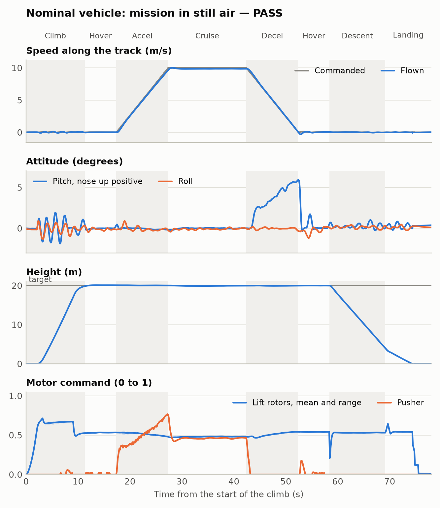

# aeroprop-v2 Docker 실행과 해석

실행일: 2026-10-13. **stock PX4로 nominal 및 가정한 4 m/s 양쪽 측풍 임무는 통과했습니다.
결합 stress 7개는 모두 개발 기준을 벗어났습니다. 실제 동체 공력이나 야외 운용 범위를
검증한 결과는 아닙니다.** CFD는 이번 작업에서 수행하지 않았습니다.

## 1. 실제로 실행한 환경

- macOS Apple silicon의 Docker Desktop, Linux ARM64, 8 CPU / 약 8 GB RAM.
- Ubuntu 24.04, PX4 v1.17.0 `d6f12ad1c4f70ad3230afd7d86e971421e02fef4`, Gazebo Sim 8.15.0.
- `simulation/Dockerfile`을 실제 빌드하고 공력 플러그인을 Gazebo 라이브러리에 연결해 컴파일·로딩.
- Docker 내부 Python/C++ 시험 **53개 통과**, pyflakes 통과.
- 이미지 ID: `sha256:9a10d6eba505d4b1c80d6c25fe53a9ecc488982be4f79d88ec24bebe0cf4a992`.

Docker Hub의 TLS/중단 오류 후 Google의 공개 Ubuntu mirror로 base image를 받아 빌드했습니다.
PX4 펌웨어 소스는 수정하지 않았습니다. 실제 요청값은 부팅 후 readback했고, 아래 10개
case의 전체 실효 파라미터 덤프도 모두 완료됐습니다.

[수치·case별 manifest](evaluation/docker_sitl_results.json)와
[nominal 실효 파라미터](evaluation/docker_baseline_effective_params.json)를 보존합니다.
ULog, SDF, `aero.csv`, 콘솔과 개별 결과는 repo의 `out/sitl-runs/`에 남아 있으며 git ignore 대상입니다.
초기 yaw 설정 실패와 제외한 transport 충돌 실행은 [진단 기록](evaluation/docker_diagnostics.json)에 있습니다.
JSON의 `/workspace/...`는 컨테이너 경로이고 호스트에서는 repo 최상위로 바꾸면 됩니다.
이미지·raw log까지 장기 보존하려면 이 파일들도 별도 보관해야 합니다.

## 2. 비행을 돌리며 발견한 수정 사항

첫 nominal은 비행·착륙했지만 allocator 토크 미달이 전진 구간의 99.4%로 기록됐습니다.
roll/pitch 잔차는 거의 0이고 yaw 잔차만 남았습니다. 원인은 CT=1, |KM|=0.03 설정에서
PX4 v1.17이 절댓값 0.05 이하인 yaw 행 전체를 제거한 것이었습니다.

다섯 모터의 공통 상대 CT를 6.5로 바꾸어 이 문턱을 넘겼습니다. 실제 모델의 추력·반토크와
KM=0.03은 바꾸지 않았습니다. 수정 후 nominal의 토크 미달은 0%, yaw 최대 오차는
12.18°에서 2.50°로 줄었습니다. 정규화와 소스 근거는 [제어 문서](../../docs/02_control_concept.md)에 있습니다.

ULog에는 같은 simulator tick의 중복 timestamp가 있었습니다. 중복을 하나로 세고
역행·실제 공백은 실패시키도록 판정을 수정했습니다. 허용 공백이나 비행 기준은 늘리지 않았습니다.
중단된 비행도 관측한 tilt 등의 진단값을 남기며 완료·착륙 조건이 없어 통과할 수 없습니다.

별도 컨테이너에서 동시에 시작한 첫 측풍 두 번은 PID와 instance가 같아 Gazebo partition이
겹쳤고, 중복 IMU/시각 오류로 arming하지 못했습니다. 이 두 실행은 물리 평가에서 제외했습니다.
partition을 UUID로 바꾸고 양쪽 case를 다시 실행했습니다. 아래는 격리 후 결과입니다.
한 컨테이너에서 서로 다른 PID/instance로 수행한 corner 결과는 이 충돌의 영향을 받지 않았습니다.

## 3. 수정 후 10개 선택 case

고도 오차는 hover1–hover2, yaw 오차는 가속–감속, tilt는 상승–착륙 구간입니다.
wing share는 주익의 최대 world 수직 힘/무게이며 실측이 아닌 simulator truth입니다.
`—`는 해당 단계까지 가지 않아 계산하지 못한 값입니다. 누락값을 통과로 처리하지 않습니다.

| case | 판정 | 최대 tilt (°) | 고도 오차 (m) | yaw 오차 (°) | 최대 wing share |
|---|---|---:|---:|---:|---:|
| nominal | PASS | 5.91 | 0.16 | 2.50 | 12.5% |
| 왼쪽 측풍 4 m/s | PASS | 5.87 | 0.13 | 1.26 | 9.3% |
| 오른쪽 측풍 4 m/s | PASS | 6.94 | 0.16 | 1.63 | 10.0% |
| heavy + low voltage + front loss | FAIL | 11.18 | — | — | 0.7% |
| heavy + low voltage + rear loss | FAIL | 10.98 | — | — | 0.7% |
| high lift + braking | FAIL | 13.10 | 0.58 | 2.74 | 50.6% |
| 오른쪽 측풍 + gust | FAIL | 29.86 | 12.43 | 161.87 | 63.1% |
| 왼쪽 측풍 + gust | FAIL | 36.91 | 3.56 | 134.03 | 26.3% |
| tailwind + low speed | FAIL | 41.42 | 0.19 | 1.01 | 8.5% |
| weak pusher + headwind | FAIL | 8.37 | 0.32 | 0.60 | 18.9% |

이는 의도적으로 고른 **조건별 시험 10건**입니다. 3/10을 신뢰도나 실제 비행 성공 확률로
해석하지 않습니다. 전체 OAT 61건·wind 64건·random 100건을 새 모델로 돌린 것은 아닙니다.
임계 풍속을 찾는 이분 탐색이나 반복 seed 시험도 수행하지 않았습니다.

### nominal의 실제 추종

순항 평균 9.856 m/s, 순항 마지막 5초의 최대 속도 오차 0.151 m/s였습니다.
전진 구간 푸셔 최대 명령 0.766, 리프트 명령 범위 0.455–0.561, 상한/하한 포화와 토크
미달은 0%였습니다. 착륙 오차 0.039 m, land detector 근처 EKF 속력 0.029 m/s였습니다.
착륙 속력은 충격 직전 속도나 구조 하중을 뜻하지 않습니다.



### 실패가 보여 주는 한계

- **weak pusher:** 푸셔 15 N, 유입 척도 25 m/s, 정풍 8 m/s에서 최대 지상 속도가 약
  2.62 m/s에 그쳤고 가속 timeout이 났습니다. 푸셔 포화 비율은 96%였습니다.
- **high lift:** 6 kg, incidence 4°, 14 m/s, 2 m/s² 가감속에서 비행·착륙은 했지만
  wing share 약 51%와 푸셔 포화 12%가 개발 상한 40%/10%를 넘었습니다. 추락과 동의어는 아닙니다.
- **heavy/loss:** 8 kg, 모터당 정적 27.5 N, 전방 또는 후방 효율 0.65, 90초 전압 감소를
  겹치면 최대 EKF 높이가 각각 0.10/0.14 m 정도여서 상승을 완료하지 못했습니다.
  합계 추력만 보는 것으로 전후 trim과 자세 여유를 확인할 수 없습니다.
- **side gust:** 8 m/s 측풍, 40% gust, 수직 잡음 1 m/s, side CP +0.4 m, 물리 KM=0.02를
  겹치면 yaw와 리프트 포화가 크게 발생했습니다. 기준 yaw를 유지한 안정 순항으로 볼 수 없습니다.
- **tailwind:** 8 m/s 배풍과 6 m/s 순항 설정에서 상승 중 pitch가 41.42°까지 갔습니다.
  순항 고도 오차만 봤다면 놓쳤을 문제입니다.

## 4. 큰 동체가 만드는 외란은 얼마나 반영했는가

**일부만 반영했습니다.** 동체의 전후·좌우·수직 저항과 작용점 모멘트, 주익/평판 하중,
로터 항력과 추진 손실은 있습니다. 하지만 nominal body CP=CG이고, body/boom의 독립
양력·모멘트 지도나 α/β 안정 미계수, CP 이동, rotor–body 간섭은 없습니다.
constant angular damping도 실제 안정성을 검증한 계수가 아닙니다.

현재 가정 Cd=1, side area=0.15 m²에서는 몸체에 순수 측풍 4 m/s가 걸릴 때 약 1.44 N,
8 m/s에서는 약 5.78 N의 측력이 계산됩니다. CP가 CG보다 0.4 m 앞이면 yaw 모멘트는 각각
약 0.58 / 2.31 N·m입니다. 이는 **현재 저차 수식으로 계산한 예시**이며 실기체 하중이 아닙니다.
큰 모멘트는 리프트 로터의 yaw 여유와 경쟁하고, 양력이 리프트를 덜게 하면 더 불리해집니다.

따라서 CP=CG인 4 m/s 측풍 통과를 실기체 측풍 허용값으로 쓰지 않습니다.
[실제 QuadPlane 풍동 연구](https://arxiv.org/html/2301.12316v1)도 구조·전후 로터 간섭에 의한
pitch 모멘트를 측정했지만 sideslip 시험은 포함하지 않았습니다. 다른 기체의 계수를
우리 동체의 yaw/sideforce 검증으로 가져올 수 없습니다.

우선 실제 CG와 CP 범위, body/boom의 6축 하중 vs 속도·α·β·RPM을 확보해야 합니다.
필요한 경우 동체 단독 → 날개 결합 → rotor disk CFD와 측정을 비교합니다. 전체 기체 하중
지도를 넣을 때는 기존 wing/tail/rotor 항을 분리하거나 교체하여 중복 계산하지 않아야 합니다.

## 5. 지금 이 시뮬레이션으로 말할 수 있는 것

통합된 PX4 제어/할당, 미션 추종, 양력에 따른 리프트 감소와 가정한 외란·추진 손실의
영향을 비교하는 **개발·민감도 도구**로는 의미가 있습니다. 실제 실행에서 yaw 할당 설정
문제와 불가능한 추진 조건, 저고도 tilt와 측풍의 취약 조건을 찾아냈습니다.

실측으로 검증한 공력 모델, 비행 허용 범위, endurance, 고장 확률이나 실기 안전성의 증거는
아닙니다. 다음 우선순위는 추력/CG/관성/동체 하중 측정과 모델 대조, 그 자료에 근거한
운용 envelope, 이후 stock과 custom PX4의 동일 조건 비교입니다.
[포함·제외 물리](../../docs/03_simulation.md)와 [custom PX4·CFD 단계](../../docs/07_research_and_custom_px4.md)를 함께 읽습니다.

## 6. 재실행

환경과 플러그인 준비는 [Docker 안내](../../simulation/README.md)를 따릅니다.

```bash
bash simulation/docker_run.sh python3 -m pytest -q
bash simulation/docker_run.sh python3 -m psi_vtol.sim.run_case --case nominal --json /workspace/out/nominal-repeat.json
bash simulation/docker_run.sh python3 -m psi_vtol.plots --record out/nominal-repeat.json
bash simulation/docker_run.sh python3 -m psi_vtol.sim.run_case --set wind_speed_mps=4 --set wind_from_deg=90
bash simulation/docker_run.sh python3 -m psi_vtol.sim.run_case --set wind_speed_mps=4 --set wind_from_deg=270
bash simulation/docker_run.sh python3 -m psi_vtol.sim.sweep corners --jobs 2
```

Gazebo/PX4 센서 잡음과 gust의 random seed를 완전히 고정하지 않았으므로 소수점까지 같은
결과를 보장하지 않습니다. case별 manifest의 값·소스·플러그인 hash와 실효 파라미터를 대조합니다.
